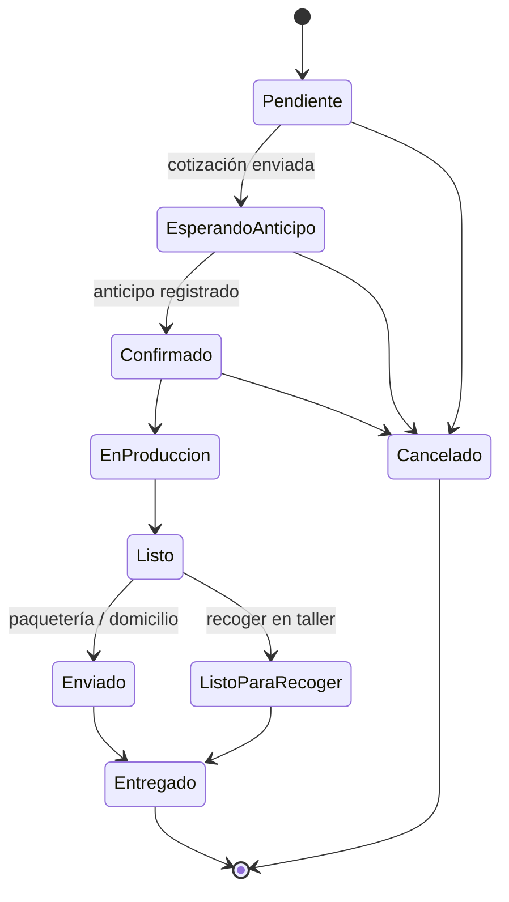

# 🐍 Ouroboros — E-commerce

> Documento base del proyecto: visión, decisiones, flujos, modelo de datos y roadmap con checklist para trazar el progreso paso a paso.

**Última actualización:** 22 de octubre de 2026
**Estado general:** 🟡 Fase 1 en progreso (Fase 0 completa salvo el logo, que depende del negocio)

---

## 1. Visión

Tienda en línea sencilla, profesional y bonita para **Ouroboros**, un negocio de productos personalizados y con diseños de anime / cultura pop:

- Playeras y sudaderas estampadas (catálogo y personalizadas)
- Tazas sublimadas y otros sublimados (playmats, mousepads, etc.)
- Termos con grabado láser
- Velas
- Productos Cricut (vinil de corte, stickers)
- Impresiones 3D

El cliente puede **pedir productos del catálogo** o **solicitar encargos especiales**. Cada pedido genera un **folio** y se confirma por **WhatsApp** mediante un enlace con mensaje prellenado. El admin gestiona todo desde un **panel simple**.

**No es** una tienda con pago en línea: los pagos (anticipo y liquidación) se acuerdan por WhatsApp y se registran en el panel.

---

## 2. Decisiones tomadas

| Tema                                      | Decisión                                                                                                                                                                                                                                |
| ----------------------------------------- | --------------------------------------------------------------------------------------------------------------------------------------------------------------------------------------------------------------------------------------- |
| Stack                                     | SvelteKit (Svelte 5) + Supabase + ImageKit, deploy en Vercel                                                                                                                                                                            |
| UI                                        | Tailwind CSS + shadcn-svelte                                                                                                                                                                                                            |
| Cuentas de cliente                        | No. Checkout como invitado                                                                                                                                                                                                              |
| Admin                                     | Un solo usuario (email + contraseña con Supabase Auth)                                                                                                                                                                                  |
| Cobro                                     | Anticipo acordado por WhatsApp y registrado en el panel                                                                                                                                                                                 |
| Anticipo                                  | Monto manual por pedido (el panel sugiere 50% del total)                                                                                                                                                                                |
| Entrega                                   | Recoger en taller/tienda · Entrega local a domicilio · Paquetería nacional                                                                                                                                                              |
| Costo de envío                            | Siempre se cotiza por WhatsApp; el admin lo captura en el panel                                                                                                                                                                         |
| Precio por talla                          | Precio base + recargo para tallas grandes (ej. XXL+)                                                                                                                                                                                    |
| Personalización de productos del catálogo | Se cotiza por WhatsApp; el admin captura el extra                                                                                                                                                                                       |
| Encargos especiales                       | Se muestra "desde $X" por tipo; precio final cotizado                                                                                                                                                                                   |
| Imágenes por color                        | Mockup automático: diseño sobre prenda base (overlays de ImageKit)                                                                                                                                                                      |
| Folio                                     | `OUR-AAMM-NNNN` (ej. `OUR-2610-0042`), consecutivo reinicia cada mes                                                                                                                                                                    |
| WhatsApp del negocio                      | +52 961 242 3984 → `https://wa.me/529612423984`                                                                                                                                                                                         |
| Estilo visual                             | Oscuro premium: negro + dorado, morado de acento                                                                                                                                                                                        |
| Versión de SvelteKit                      | SvelteKit 3: alias `#lib` (imports de package.json, no resuelve carpetas: importar `.../index.js`) y variables de entorno declaradas en `src/env.ts`, importadas desde `$app/env/public` / `$app/env/private` (`$env/*` está deprecado) |
| Fuentes                                   | Autohospedadas con Fontsource (Inter Variable y Cinzel), sin Google Fonts                                                                                                                                                               |
| Firma de URLs de ImageKit                 | Firma propia (`src/lib/server/imagekit-signing.ts`, HMAC-SHA1 igual al SDK) con expiración fija por día; el SDK solo soporta "ahora + N segundos"                                                                                       |
| Subidas desde el admin                    | Diseños y fotos de producto se suben desde el panel en Fase 2 reutilizando `src/lib/server/imagekit.ts`; los diseños se suben como archivos privados de ImageKit                                                                        |
| Dinero en la BD                           | Enteros en centavos (MXN) en todas las columnas de precio y monto; `null` en personalización, envío, anticipo y precio de encargo significa "por cotizar"                                                                               |
| Rol de admin                              | `public.is_admin()`: usuario autenticado con `app_metadata.role = 'admin'` (solo se asigna con la llave secreta)                                                                                                                        |
| Permisos de tablas nuevas                 | Las tablas y funciones nuevas en `public` nacen cerradas (default privileges revocados): cada migración da sus grants y activa RLS                                                                                                      |
| Precio de encargo                         | `custom_requests.precio_final` (null = por cotizar), reflejado en `orders.subtotal`; la BD valida `total = subtotal − descuentos + personalización + envío`                                                                             |
| Folio en BD                               | `next_folio(prefijo, fecha)` solo para `service_role`; periodo en hora de `America/Mexico_City`; error si pasa de 9999 en un mes                                                                                                        |

---

## 3. Identidad visual

### 3.1 Paleta (tokens)

| Token                                  | Valor                             | Uso                                         |
| -------------------------------------- | --------------------------------- | ------------------------------------------- |
| `--bg`                                 | `#0A0A0B`                         | Fondo general                               |
| `--surface`                            | `#141416`                         | Cards, paneles                              |
| `--surface-raised`                     | `#1C1C20`                         | Hover, modales, fondo de imagen de producto |
| `--border`                             | `#2A2A30`                         | Bordes y divisores                          |
| `--text`                               | `#F5F3EE`                         | Texto principal                             |
| `--text-muted`                         | `#A1A1AA`                         | Texto secundario                            |
| `--gold`                               | `#D4AF37`                         | Color de marca, CTAs principales, precios   |
| `--gold-light`                         | `#F2D27A`                         | Hover de CTAs, brillos                      |
| `--purple`                             | `#6D28D9`                         | Acentos: badges, chips activos, enlaces     |
| `--purple-light`                       | `#A78BFA`                         | Hover de acentos, focus ring                |
| `--success` / `--warning` / `--danger` | `#22C55E` / `#F59E0B` / `#EF4444` | Estados                                     |

> Las imágenes de producto se muestran sobre `--surface-raised` con un degradado radial suave para que las prendas negras no se pierdan sobre el fondo.

### 3.2 Tipografía

- **Títulos:** Cinzel o Marcellus (serif con carácter, en línea con el logo).
- **Texto e interfaz:** Inter.

### 3.3 Logo

- [ ] Conseguir el logo original en PNG con fondo transparente (o SVG).
- [ ] Crear versión simplificada (círculo + cabeza de serpiente, o "O" dorada) para favicon, navbar móvil y marca de agua.

### 3.4 Referencias de UX

Tiendas de moda conocidas (Zara, Uniqlo, H&M): mucha imagen, poco texto, grids limpios, swatches de color en las cards y navegación por categorías clara.

---

## 4. Estructura del catálogo

### 4.1 Taxonomía inicial (editable desde el admin)

| Categoría               | Subcategoría estrella ⭐ | Otras subcategorías                                                     |
| ----------------------- | ------------------------ | ----------------------------------------------------------------------- |
| Ropa                    | Playeras con diseño      | Sudaderas con diseño, Playeras personalizadas, Sudaderas personalizadas |
| Sublimación             | Tazas                    | Playmats, Mousepads, Otros sublimados                                   |
| Grabado láser           | Termos                   | Otros grabados                                                          |
| Cricut                  | Stickers                 | Vinil de corte                                                          |
| Impresión 3D            | Impresiones 3D           | —                                                                       |
| Velas                   | Velas                    | —                                                                       |
| **Encargos especiales** | —                        | (botón de acceso siempre visible)                                       |

**Colecciones por fandom** (anime, gaming, películas, etc.): etiquetas transversales a las categorías, con página propia y filtro.

### 4.2 Navegación y layout

- **Navbar:** logo, categorías principales, búsqueda, favoritos, carrito y botón "Encargos especiales".
- **Submenú** (debajo del navbar, al entrar a una categoría): chips horizontales con sus subcategorías; en móvil, scroll horizontal.
- **Hero de la categoría estrella:** banner con la subcategoría destacada y su CTA.
- **Body:** grid completo de productos de la categoría con filtros (color, talla, precio, fandom, en stock / bajo pedido) y orden (nuevos, precio).

### 4.3 Card de producto

- Imagen principal (mockup del color seleccionado).
- **Swatches** de los colores disponibles: al tocarlos o pasar el cursor, la imagen cambia sin recargar.
- Nombre, precio "desde", badge de fandom y badge "En stock" / "Bajo pedido".
- Botón de favorito (corazón).

### 4.4 Página de producto

- Galería de imágenes según el color elegido.
- Selector de color (swatches) y de talla, con recargo visible en tallas grandes.
- Enlace a la **guía de tallas** (modal con medidas).
- Cantidad, con aviso de **precio por mayoreo** si aplica.
- Opción **"Personalizar"**: texto libre y/o imagen de referencia, con la etiqueta "Personalización por cotizar".
- Botones: Agregar al carrito · Favorito.
- Productos relacionados (misma colección o categoría).
- Reseñas con foto del producto (si hay).

---

## 5. Sistema de imágenes (ImageKit)

### 5.1 Estructura de carpetas

```
/ouroboros
  /bases        → prendas base lisas por tipo y color (públicas)
  /designs      → diseños PNG transparentes (PRIVADOS)
  /products     → fotos reales de productos sin mockup (tazas, termos, velas…)
  /brand        → logo, marca de agua, banners
  /orders       → archivos de clientes y comprobantes (PRIVADOS)
  /gallery      → galería de trabajos y fotos de reseñas
```

### 5.2 Mockup automático

1. Se sube una **prenda base** por tipo y color (ej. playera negra, blanca, roja, azul), definiendo su **área de impresión** (x, y, ancho) y si es clara u oscura.
2. Se sube el **diseño** como PNG transparente; opcionalmente una **versión alterna** para prendas claras (ej. tinta oscura).
3. La URL de ImageKit combina: prenda base + diseño como overlay en el área de impresión + marca de agua.
4. Con un solo diseño se generan automáticamente todas las variantes de color.

> Los productos con superficie curva (tazas, termos) usan **fotos reales** en lugar de mockup.

### 5.3 Protección

Ninguna imagen web es 100% indescargable; el objetivo es que robarla no valga la pena:

- El PNG original del diseño nunca se expone: vive en carpeta privada y solo se sirve compuesto.
- Resolución máxima servida acotada (ej. 1000 px) y calidad optimizada.
- Marca de agua sutil del logo como overlay.
- URLs firmadas generadas en el servidor (la llave privada nunca llega al navegador).
- En la interfaz: sin clic derecho ni arrastre sobre imágenes, y una capa transparente encima de la imagen.

### 5.4 Caché y rendimiento

- **Expiración fija por periodos** en las URLs firmadas (ej. expiran al final del día). Así la URL no cambia en cada recarga y el navegador y la CDN la reutilizan.
- CDN de ImageKit + encabezados `Cache-Control` largos.
- Formatos modernos automáticos (WebP/AVIF), tamaños responsivos (`srcset`) y carga diferida (`loading="lazy"`).
- Placeholder borroso de baja resolución mientras carga la imagen.

> ✅ **Spike Fase 0 (2026-10-22):** los overlays con diseños privados funcionan dentro de URLs firmadas; el diseño sin firma devuelve 403. Configuración en la skill `ouroboros-imagekit`.

---

## 6. Flujos

### 6.1 Pedido del catálogo (cliente)

1. Navega el catálogo, entra a un producto y elige color, talla, cantidad y personalización (opcional).
2. Agrega al carrito (guardado en el navegador).
3. **Checkout:**
   - Nombre y WhatsApp (10 dígitos).
   - Método de entrega: recoger · domicilio local · paquetería.
   - Dirección (solo si es domicilio o paquetería): calle y número, colonia, CP, ciudad, estado, referencias.
   - Cupón de descuento (opcional) y notas.
   - Resumen: subtotal + descuentos; envío y personalización marcados "por cotizar".
4. Al confirmar, el servidor crea el pedido con folio `OUR-AAMM-NNNN` y estado **Pendiente**.
5. Pantalla de éxito con el folio, enlace de seguimiento y botón **"Enviar pedido por WhatsApp"**, que abre `wa.me/529612423984` con el mensaje prellenado.

### 6.2 Encargo especial (cliente)

1. Botón "Encargos especiales" → formulario.
2. Elige tipo de producto (muestra "desde $X"), escribe la descripción, sube imágenes de referencia, indica cantidad y fecha deseada.
3. Datos de contacto y entrega (igual que en el checkout).
4. Se crea el pedido tipo **encargo** con folio y se abre WhatsApp con el mensaje de encargo.

### 6.3 Gestión del pedido (admin)

1. Llega el mensaje de WhatsApp y, en tiempo real, el pedido aparece en el panel.
2. El admin abre el detalle y captura lo que se cotiza: costo de envío, extra de personalización, precio final del encargo.
3. Define el **anticipo requerido** (sugerido 50%) y envía por WhatsApp la plantilla **"Cotización y anticipo"** → estado **Esperando anticipo**.
4. El cliente manda el comprobante por WhatsApp; el admin registra el pago (monto, método, fecha, foto opcional) → estado **Confirmado**.
5. Avanza estados (En producción → Listo → Enviado / Listo para recoger → Entregado), cada uno con su botón **"Avisar por WhatsApp"**.
6. Al entregar registra la liquidación; el panel marca el pedido como **Liquidado** y la plantilla final invita a dejar reseña.

### 6.4 Estados del pedido



Cada cambio de estado queda en el historial del pedido (fecha y nota opcional).

### 6.5 Seguimiento por folio (cliente)

- Página `/seguimiento`: el cliente ingresa **folio + últimos 4 dígitos de su WhatsApp** (evita que alguien consulte pedidos ajenos adivinando folios).
- Muestra estado actual, línea de tiempo, resumen, total, pagado y saldo, y guía de paquetería si aplica.
- Cuando el pedido está Entregado, aparece el formulario para dejar reseña con foto.

---

## 7. Precios y totales

```
subtotal          = Σ (precio_base + recargo_talla) × cantidad
desc_mayoreo      = según escala de volumen del producto o categoría
desc_cupón        = % o monto fijo sobre el subtotal con mayoreo
personalización   = capturado por admin (por cotizar)
envío             = capturado por admin (por cotizar)
total             = subtotal − desc_mayoreo − desc_cupón + personalización + envío
pagado            = Σ pagos registrados
saldo             = total − pagado
```

- **Recargo por talla:** configurado por tipo de prenda (ej. XXL +$30, 3XL +$50).
- **Mayoreo:** escalas por cantidad (ej. 6+ piezas −10%, 12+ piezas −15%).
- **Cupones:** código, tipo (% o fijo), valor, mínimo de compra, vigencia, usos máximos.
- Los precios de cada pedido se guardan como **snapshot**: cambiar el catálogo después no altera pedidos existentes.

---

## 8. Plantillas de WhatsApp

Editables desde el admin. Variables disponibles: `{{folio}}`, `{{nombre}}`, `{{resumen}}`, `{{metodo_entrega}}`, `{{subtotal}}`, `{{descuentos}}`, `{{personalizacion}}`, `{{envio}}`, `{{total}}`, `{{anticipo}}`, `{{pagado}}`, `{{saldo}}`, `{{datos_bancarios}}`, `{{direccion_taller}}`, `{{guia}}`, `{{link_seguimiento}}`.

| Clave                 | Dirección         | Cuándo                         |
| --------------------- | ----------------- | ------------------------------ |
| `pedido_nuevo`        | Cliente → negocio | Al terminar el checkout        |
| `encargo_nuevo`       | Cliente → negocio | Al enviar un encargo           |
| `cotizacion_anticipo` | Negocio → cliente | Pendiente → Esperando anticipo |
| `anticipo_recibido`   | Negocio → cliente | → Confirmado                   |
| `en_produccion`       | Negocio → cliente | → En producción                |
| `listo_recoger`       | Negocio → cliente | → Listo para recoger           |
| `enviado`             | Negocio → cliente | → Enviado                      |
| `entregado_resena`    | Negocio → cliente | → Entregado                    |
| `cancelado`           | Negocio → cliente | → Cancelado                    |

**Ejemplo `pedido_nuevo`:**

```
¡Hola, Ouroboros! 🐍✨
Acabo de hacer mi pedido *{{folio}}*

👤 {{nombre}}
📦 Entrega: {{metodo_entrega}}

{{resumen}}

Subtotal: {{subtotal}}
Envío y personalización: por cotizar

Quedo pendiente de la cotización final y los datos para el anticipo. ¡Gracias!
```

Formato de cada línea de `{{resumen}}`: `• 2× Playera Akatsuki · Negro · M — $560`

**Ejemplo `cotizacion_anticipo`:**

```
¡Hola, {{nombre}}! 🐍 Gracias por tu pedido *{{folio}}*

Total: {{total}} (incluye envío: {{envio}})
Para iniciar la producción necesitamos un anticipo de *{{anticipo}}*.

{{datos_bancarios}}

Mándanos tu comprobante por aquí y lo ponemos en marcha 🎨
Sigue tu pedido aquí: {{link_seguimiento}}
```

**Enlaces:**

- Cliente → negocio: `https://wa.me/529612423984?text=` + `encodeURIComponent(mensaje)`
- Negocio → cliente: `https://wa.me/{whatsapp_cliente}?text=` + `encodeURIComponent(mensaje)` (`orders.cliente_whatsapp` ya se guarda normalizado como `52XXXXXXXXXX`)

---

## 9. Features aprobadas

| #   | Feature                                                  | Fase |
| --- | -------------------------------------------------------- | ---- |
| F1  | Seguimiento de pedido por folio                          | 7    |
| F2  | Registro de anticipo y pagos en el panel                 | 6    |
| F3  | Plantillas de WhatsApp editables                         | 6    |
| F4  | Búsqueda y filtros (color, talla, precio, fandom, stock) | 3    |
| F5  | Guía de tallas                                           | 3    |
| F6  | Dashboard (pedidos por estado, ventas del mes)           | 8    |
| F7  | Notas internas y archivos en cada pedido                 | 6    |
| F8  | Colecciones por fandom                                   | 3    |
| F9  | Favoritos guardados en el navegador                      | 3    |
| F10 | Cupones de descuento                                     | 8    |
| F11 | Precios por mayoreo / volumen                            | 8    |
| F12 | Galería de trabajos y reseñas con foto (moderadas)       | 7    |
| F13 | Vista previa al compartir en redes (Open Graph)          | 9    |
| F14 | Productos "en stock" vs "bajo pedido"                    | 3    |

**Descartada por ahora:** tiempo de producción visible por producto.

---

## 10. Modelo de datos (Supabase / Postgres)

| Tabla                  | Campos principales                                                                                                                                                                                                                                  |
| ---------------------- | --------------------------------------------------------------------------------------------------------------------------------------------------------------------------------------------------------------------------------------------------- |
| `settings`             | whatsapp_negocio, datos_bancarios, direccion_taller, horarios, anticipo_sugerido_pct                                                                                                                                                                |
| `categories`           | id, slug, nombre, parent_id, es_estrella, orden, imagen_hero, activo                                                                                                                                                                                |
| `collections`          | id, slug, nombre, imagen (fandoms)                                                                                                                                                                                                                  |
| `garment_types`        | id, nombre (playera, sudadera), tallas[], recargos_talla (json), guia_tallas (json)                                                                                                                                                                 |
| `garment_bases`        | id, garment_type_id, color_nombre, color_hex, imagekit_path, area_impresion (x, y, ancho), es_clara                                                                                                                                                 |
| `designs`              | id, nombre, path_prenda_oscura, path_prenda_clara                                                                                                                                                                                                   |
| `products`             | id, slug, nombre, descripcion, category_id, tipo_imagen (mockup / foto), garment_type_id, design_id, precio_base, modo_stock (stock / bajo_pedido), permite_personalizar, activo, destacado                                                         |
| `product_colors`       | product_id, garment_base_id (colores disponibles del producto)                                                                                                                                                                                      |
| `product_images`       | product_id, imagekit_path, orden (productos con foto real)                                                                                                                                                                                          |
| `product_stock`        | product_id, garment_base_id, talla, cantidad (solo modo stock)                                                                                                                                                                                      |
| `product_collections`  | product_id, collection_id                                                                                                                                                                                                                           |
| `volume_pricing`       | id, product_id o category_id, cantidad_min, descuento_pct                                                                                                                                                                                           |
| `custom_request_types` | id, nombre, precio_desde, activo                                                                                                                                                                                                                    |
| `coupons`              | id, codigo, tipo, valor, minimo, vigencia, usos_max, usos                                                                                                                                                                                           |
| `folio_counters`       | periodo (AAMM), ultimo_numero                                                                                                                                                                                                                       |
| `orders`               | id, folio, tipo (catalogo / encargo), estado, cliente_nombre, cliente_whatsapp, metodo_entrega, direccion (json), notas_cliente, coupon_id, subtotal, desc_mayoreo, desc_cupon, personalizacion, envio, total, anticipo_requerido, guia, timestamps |
| `order_items`          | order_id, product_id, nombre_snapshot, color, talla, cantidad, precio_unitario, recargo_talla, personalizacion_texto, personalizacion_archivo                                                                                                       |
| `custom_requests`      | order_id, custom_request_type_id, descripcion, cantidad, fecha_deseada, archivos_referencia[]                                                                                                                                                       |
| `payments`             | id, order_id, tipo (anticipo / abono / liquidacion), monto, metodo, fecha, comprobante_path                                                                                                                                                         |
| `order_events`         | id, order_id, estado, nota, fecha                                                                                                                                                                                                                   |
| `order_notes`          | id, order_id, texto, fecha (internas)                                                                                                                                                                                                               |
| `order_files`          | id, order_id, imagekit_path, descripcion                                                                                                                                                                                                            |
| `wa_templates`         | clave, nombre, cuerpo                                                                                                                                                                                                                               |
| `reviews`              | id, order_id, product_id, calificacion, texto, foto_path, aprobada                                                                                                                                                                                  |
| `gallery_items`        | id, imagekit_path, titulo, collection_id, orden                                                                                                                                                                                                     |

**Seguridad (RLS):**

- Lectura pública solo de catálogo activo, colecciones, galería y reseñas aprobadas.
- Pedidos: se crean únicamente desde un endpoint del servidor (validación de precios en servidor, nunca confiar en el carrito). Sin lectura pública; el seguimiento pasa por endpoint con folio + 4 dígitos.
- Todo lo demás solo para el admin autenticado.

**Folio:** función en Postgres que incrementa `folio_counters` de forma atómica y devuelve `OUR-AAMM-NNNN`.

---

## 11. Panel de admin

- **Dashboard:** pedidos por estado, ventas del mes, anticipos pendientes, pedidos nuevos de hoy.
- **Pedidos:** lista con filtros por estado, tipo y fecha, y búsqueda por folio, nombre o teléfono. Badge en tiempo real para pedidos nuevos.
- **Detalle de pedido:** resumen, captura de cotización (envío, personalización, precio de encargo), anticipo requerido, pagos y saldo, cambio de estado, botón "Avisar por WhatsApp", notas internas, archivos e historial.
- **Catálogo:** categorías (con categoría estrella), colecciones, productos, prendas base (con editor visual del área de impresión), diseños (subida y vista previa en todos los colores) y stock.
- **Precios:** recargos por talla, escalas de mayoreo, cupones, tipos de encargo con "desde $X".
- **Contenido:** galería, moderación de reseñas, banners de categoría.
- **Ajustes:** plantillas de WhatsApp, datos bancarios, dirección del taller, horarios, anticipo sugerido.

---

## 12. Roadmap y checklist

Leyenda: ⬜ pendiente · 🟡 en progreso · ✅ terminado

### Fase 0 — Setup y validaciones 🟡

- [x] Crear repositorio y proyecto SvelteKit (Svelte 5 + TypeScript)
- [x] Configurar Tailwind, shadcn-svelte y tokens de la paleta
- [x] Crear proyecto en Supabase y variables de entorno
- [x] Crear cuenta y estructura de carpetas en ImageKit
- [x] **Spike:** overlay de diseño privado sobre prenda base con URL firmada + marca de agua
- [x] **Spike:** URLs firmadas con expiración fija y verificación de caché
- [ ] Logo original y versión simplificada
- [x] Deploy inicial en Vercel

### Fase 1 — Base de datos 🟡

- [x] Migraciones de todas las tablas
- [x] Políticas RLS
- [x] Función de folio atómico
- [ ] Datos semilla: categorías, tipos de prenda, prendas base, plantillas de WhatsApp, ajustes
- [ ] Usuario admin

### Fase 2 — Admin: catálogo ⬜

- [ ] Login de admin y layout del panel
- [ ] CRUD de categorías (con categoría estrella) y colecciones
- [ ] Prendas base con editor de área de impresión
- [ ] Subida de diseños con vista previa en todos los colores
- [ ] CRUD de productos (mockup y foto real) con colores, stock / bajo pedido
- [ ] Recargos por talla y guía de tallas por tipo de prenda

### Fase 3 — Tienda: catálogo ⬜

- [ ] Layout: navbar, submenú de subcategorías, footer
- [ ] Home (destacados, colecciones, CTA de encargos)
- [ ] Página de categoría con hero de categoría estrella y grid
- [ ] Card de producto con swatches que cambian la imagen
- [ ] Página de producto (colores, tallas, cantidad, personalización)
- [ ] Guía de tallas (F5)
- [ ] Búsqueda y filtros (F4)
- [ ] Páginas de colecciones por fandom (F8)
- [ ] Favoritos (F9)
- [ ] Badges en stock / bajo pedido (F14)
- [ ] Protección de imágenes en la interfaz

### Fase 4 — Carrito, checkout y WhatsApp ⬜

- [ ] Carrito persistente en el navegador
- [ ] Checkout con datos condicionales según método de entrega
- [ ] Endpoint de creación de pedido (validación y cálculo de precios en servidor)
- [ ] Generación de folio
- [ ] Pantalla de éxito con enlace `wa.me` y mensaje `pedido_nuevo`

### Fase 5 — Encargos especiales ⬜

- [ ] Admin: tipos de encargo con "desde $X"
- [ ] Formulario de encargo con subida de referencias
- [ ] Creación de pedido tipo encargo y mensaje `encargo_nuevo`

### Fase 6 — Admin: pedidos ⬜

- [ ] Lista de pedidos con filtros, búsqueda y tiempo real
- [ ] Detalle: captura de cotización y anticipo requerido
- [ ] Registro de pagos y cálculo de saldo (F2)
- [ ] Cambio de estado con historial
- [ ] Botones "Avisar por WhatsApp" por estado
- [ ] Editor de plantillas de WhatsApp (F3)
- [ ] Notas internas y archivos (F7)

### Fase 7 — Seguimiento, reseñas y galería ⬜

- [ ] Página `/seguimiento` con folio + 4 dígitos (F1)
- [ ] Formulario de reseña con foto al estar Entregado
- [ ] Moderación de reseñas en admin
- [ ] Galería de trabajos (F12)

### Fase 8 — Precios avanzados y dashboard ⬜

- [ ] Escalas de mayoreo (F11)
- [ ] Cupones de descuento (F10)
- [ ] Dashboard (F6)

### Fase 9 — Pulido y lanzamiento ⬜

- [ ] Open Graph por producto, categoría y colección (F13)
- [ ] SEO básico: títulos, descripciones, sitemap
- [ ] Optimización de imágenes, caché y rendimiento (Lighthouse)
- [ ] Pruebas en móvil y escritorio
- [ ] Carga del catálogo real
- [ ] Dominio propio y lanzamiento 🚀

---

## 13. Pendientes por definir

- [ ] Logo original en PNG transparente o SVG
- [ ] Datos bancarios para el anticipo
- [ ] Dirección y horarios del taller (para "recoger en taller")
- [ ] Medidas reales para la guía de tallas
- [ ] Fotos de prendas base lisas por color
- [ ] Precios base, recargos por talla y escalas de mayoreo
- [ ] Tipos de encargo y su "desde $X"
- [ ] Dominio (ej. `ouroboros.mx`)

---

## 14. Registro de progreso

| Fecha      | Fase       | Avance                                                                                                                       | Notas                                                                                                                                                                                                                                                                                                                                                                                                                                                                                                                                                                                                                          |
| ---------- | ---------- | ---------------------------------------------------------------------------------------------------------------------------- | ------------------------------------------------------------------------------------------------------------------------------------------------------------------------------------------------------------------------------------------------------------------------------------------------------------------------------------------------------------------------------------------------------------------------------------------------------------------------------------------------------------------------------------------------------------------------------------------------------------------------------ |
| 2026-10-21 | Definición | ✅ Documento base creado                                                                                                     | Decisiones, flujos, modelo de datos y roadmap                                                                                                                                                                                                                                                                                                                                                                                                                                                                                                                                                                                  |
| 2026-10-21 | Fase 0     | ✅ Proyecto SvelteKit 3 + Svelte 5 + TS, Tailwind v4, shadcn-svelte (vega), tokens del tema, adapter Vercel, página temporal | Repo git local (falta remoto). `npm run check/lint/test/build` pasan. Deps: supabase-js, @supabase/ssr, zod, lucide-svelte, @imagekit/nodejs                                                                                                                                                                                                                                                                                                                                                                                                                                                                                   |
| 2026-10-22 | Fase 0     | 🟡 Guía de configuración de Supabase e ImageKit; nombres de variables definidos                                              | Variables `.env`: `PUBLIC_SUPABASE_URL`, `PUBLIC_SUPABASE_PUBLISHABLE_KEY`, `SUPABASE_SECRET_KEY`, `PUBLIC_IMAGEKIT_URL_ENDPOINT`, `PUBLIC_IMAGEKIT_PUBLIC_KEY`, `IMAGEKIT_PRIVATE_KEY`, `PUBLIC_WHATSAPP_NUMBER`. `SUPABASE_PROJECT_REF` va en el shell (lo lee `.mcp.json`). Supabase en East US (N. Virginia), registro público desactivado. ImageKit: no activar "Restrict unsigned URLs" hasta cerrar los spikes; MCP de ImageKit descartado por ahora (requiere private key con acceso total). Siguiente: reconectar MCP de Supabase, `supabase login/init/link`, declarar variables en `src/env.ts`, spikes de ImageKit |
| 2026-10-22 | Fase 0     | ✅ Proyecto Supabase enlazado y variables de entorno declaradas                                                              | 7 variables validadas con zod en `src/env.ts` (el build valida el `.env`). CLI `supabase` como devDependency, `supabase init` + `link` al proyecto `wgejdiewrysbuduahptu` (sin migraciones). Módulos de servidor de ImageKit (firma con expiración fija probada contra el SDK, mockup, subida) y página temporal `/spike/imagekit` solo en dev. El MCP de Supabase sigue fallando (HTTP 400). Siguiente: correr el spike y documentar resultados                                                                                                                                                                               |
| 2026-10-22 | Fase 0     | ✅ Spikes de ImageKit: overlay privado en URL firmada y expiración fija con caché                                            | Diseño privado como capa: 200; diseño sin firma: 403; `ik-t` fijo por día; segunda carga `Hit from cloudfront`. El área de impresión va en px de la base real (la de prueba mide 1285×1224) y el diseño oscuro sobre prenda oscura requiere la versión clara. La ruta `/spike/imagekit` sigue disponible solo en dev                                                                                                                                                                                                                                                                                                           |
| 2026-10-22 | Fase 0     | ✅ Estructura de carpetas en ImageKit                                                                                        | Verificada con el SDK: `/ouroboros/{bases,brand,designs,gallery,orders,products}`                                                                                                                                                                                                                                                                                                                                                                                                                                                                                                                                              |
| 2026-10-22 | Fase 0     | ✅ Deploy inicial en Vercel                                                                                                  | Confirmado funcionando por el usuario. La Fase 0 queda abierta solo por el logo (pendiente de negocio, sección 13), que no bloquea la Fase 1. Siguiente: Fase 1 — Base de datos                                                                                                                                                                                                                                                                                                                                                                                                                                                |
| 2026-10-22 | Fase 1     | ✅ Migraciones de las 24 tablas, RLS y folio atómico aplicados al remoto; 🟡 semilla parcial                                 | Aplicado directo al proyecto remoto (sin Docker local). `npm run db:smoke` (41 pruebas: RLS anon, folio concurrente, reinicio mensual y zona horaria, semilla) pasa. Semilla: ajustes, 20 categorías, playera y sudadera, 9 plantillas de WhatsApp; las prendas base y los tipos de encargo esperan fotos y precios del negocio. Tipos generados en `src/lib/types/database.ts` (`npm run db:types`). Revisión de seguridad previa al push: sin bloqueadores. Falta: usuario admin                                                                                                                                             |
