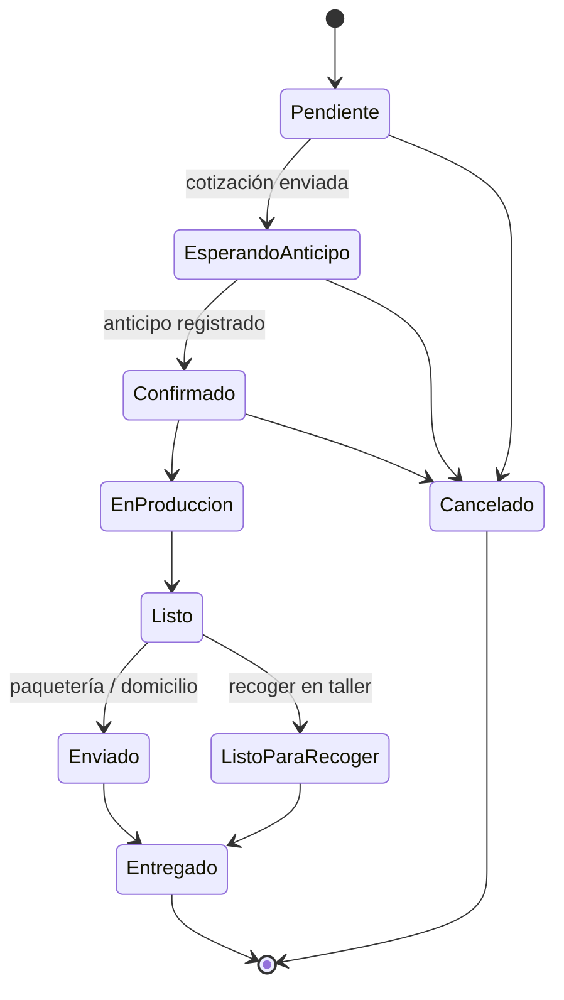

# 🐍 Ouroboros — E-commerce

> Documento base del proyecto: visión, decisiones, flujos, modelo de datos y roadmap con checklist para trazar el progreso paso a paso.

**Última actualización:** 22 de octubre de 2026
**Estado general:** 🟡 Fase 3 en progreso (Fase 2 completa)

---

## 1. Visión

Tienda en línea sencilla, profesional y bonita para **Ouroboros**, un negocio de productos personalizados y con diseños de anime / cultura pop:

- Playeras y sudaderas estampadas (catálogo y personalizadas)
- Tazas sublimadas y otros sublimados (playmats, mousepads, etc.)
- Termos con grabado láser
- Velas
- Productos Cricut (vinil de corte, stickers)
- Impresiones 3D

El cliente puede **pedir productos del catálogo** o **solicitar encargos especiales**. Cada pedido genera un **folio** y se confirma por **WhatsApp** mediante un enlace con mensaje prellenado. El admin gestiona todo desde un **panel simple**.

**No es** una tienda con pago en línea: los pagos (anticipo y liquidación) se acuerdan por WhatsApp y se registran en el panel.

---

## 2. Decisiones tomadas

| Tema                                      | Decisión                                                                                                                                                                                                                                                                                                                                                                                                                                 |
| ----------------------------------------- | ---------------------------------------------------------------------------------------------------------------------------------------------------------------------------------------------------------------------------------------------------------------------------------------------------------------------------------------------------------------------------------------------------------------------------------------- |
| Stack                                     | SvelteKit (Svelte 5) + Supabase + ImageKit, deploy en Vercel                                                                                                                                                                                                                                                                                                                                                                             |
| UI                                        | Tailwind CSS + shadcn-svelte                                                                                                                                                                                                                                                                                                                                                                                                             |
| Cuentas de cliente                        | No. Checkout como invitado                                                                                                                                                                                                                                                                                                                                                                                                               |
| Admin                                     | Un solo usuario (email + contraseña con Supabase Auth)                                                                                                                                                                                                                                                                                                                                                                                   |
| Cobro                                     | Anticipo acordado por WhatsApp y registrado en el panel                                                                                                                                                                                                                                                                                                                                                                                  |
| Anticipo                                  | Monto manual por pedido (el panel sugiere 50% del total)                                                                                                                                                                                                                                                                                                                                                                                 |
| Entrega                                   | Recoger en taller/tienda · Entrega local a domicilio · Paquetería nacional                                                                                                                                                                                                                                                                                                                                                               |
| Costo de envío                            | Siempre se cotiza por WhatsApp; el admin lo captura en el panel                                                                                                                                                                                                                                                                                                                                                                          |
| Precio por talla                          | Precio base + recargo para tallas grandes (ej. XXL+)                                                                                                                                                                                                                                                                                                                                                                                     |
| Personalización de productos del catálogo | Se cotiza por WhatsApp; el admin captura el extra                                                                                                                                                                                                                                                                                                                                                                                        |
| Encargos especiales                       | Se muestra "desde $X" por tipo; precio final cotizado                                                                                                                                                                                                                                                                                                                                                                                    |
| Gestión de pedidos                        | Cotizar, cambiar estado y registrar pagos pasan por funciones de Postgres (`quote_order`, `change_order_status`, `add_payment`) que validan las transiciones del diagrama 6.4, exigen un pago de anticipo para confirmar, limitan los pagos al saldo y guardan cada cambio en `order_events`. Solo el admin las ejecuta                                                                                                                  |
| "Tiempo real" del panel                   | La lista de pedidos se refresca cada 20 s mientras la pestaña está visible y avisa de los pedidos nuevos; no se usa Supabase Realtime porque la sesión vive en una cookie `HttpOnly` que el navegador no puede leer                                                                                                                                                                                                                      |
| Límites de peticiones                     | Tabla `rate_limits` + `hit_rate_limit` (solo `service_role`): límite por IP compartido entre instancias para pedidos (10 en 10 min), encargos (5 en 10 min) y seguimiento; el mapa en memoria queda como primera capa barata                                                                                                                                                                                                             |
| Seguimiento                               | `/seguimiento` usa una acción POST (los 4 dígitos nunca van en la URL), compara en tiempo constante y responde igual si el folio no existe o los dígitos no coinciden; límites durables de 15 intentos por IP cada 15 min y 8 por folio por hora, que fallan cerrados. El cliente ve estado, línea de tiempo, partidas, total, pagado, saldo y guía, sin teléfono ni dirección                                                           |
| Reseñas y galería                         | Una reseña por pedido, solo al estar Entregado; la foto queda privada en `orders/<folio>/` y solo se sirve con marca de agua por `/img/r/<id>` cuando el admin la publica. La galería se sube a la carpeta privada `gallery` y se sirve por `/img/g/<id>` con marca de agua                                                                                                                                                              |
| Archivos del pedido                       | Comprobantes y fotos se suben a `/ouroboros/orders/<folio>/` como WebP sin metadatos y se ven en el panel con URL firmada                                                                                                                                                                                                                                                                                                                |
| Imágenes por color                        | Mockup automático compuesto en nuestro servidor con `sharp`: prenda base local + diseño + marca de agua, servido como una sola imagen WebP de máx. 1000 px (decisión del 2026-10-22; antes eran overlays de ImageKit)                                                                                                                                                                                                                    |
| Folio                                     | `OUR-AAMM-NNNN` (ej. `OUR-2610-0042`), consecutivo reinicia cada mes                                                                                                                                                                                                                                                                                                                                                                     |
| WhatsApp del negocio                      | +52 961 242 3984 → `https://wa.me/529612423984`                                                                                                                                                                                                                                                                                                                                                                                          |
| Estilo visual                             | Decisión del usuario (2026-10-22): «quiero que tenga dos tema, dia y noche y el default se el de día». Día: papel cálido `#FAF7F2`, tinta `#17141C`, dorado y morado de acento; noche: negro + dorado. Inspirado en tiendas de moda (Zara, H&M, Uniqlo, Shein); tarjeta de producto «agregar rápido» elegida por el usuario. Propuestas en el lienzo «Ouroboros — propuestas de rediseño» |
| Versión de SvelteKit                      | SvelteKit 3: alias `#lib` (imports de package.json, no resuelve carpetas: importar `.../index.js`) y variables de entorno declaradas en `src/env.ts`, importadas desde `$app/env/public` / `$app/env/private` (`$env/*` está deprecado)                                                                                                                                                                                                  |
| Fuentes                                   | Autohospedadas con Fontsource (Inter Variable y Cinzel), sin Google Fonts                                                                                                                                                                                                                                                                                                                                                                |
| Firma de URLs de ImageKit                 | Firma propia (`src/lib/server/imagekit-signing.ts`, HMAC-SHA1 igual al SDK) con expiración fija por día; el SDK solo soporta "ahora + N segundos"                                                                                                                                                                                                                                                                                        |
| Subidas desde el admin                    | Diseños y fotos de producto se suben desde el panel en Fase 2 reutilizando `src/lib/server/imagekit.ts`; los diseños se suben como archivos privados de ImageKit                                                                                                                                                                                                                                                                         |
| Dinero en la BD                           | Enteros en centavos (MXN) en todas las columnas de precio y monto; `null` en personalización, envío, anticipo y precio de encargo significa "por cotizar"                                                                                                                                                                                                                                                                                |
| Rol de admin                              | `public.is_admin()`: usuario autenticado con `app_metadata.role = 'admin'` (solo se asigna con la llave secreta)                                                                                                                                                                                                                                                                                                                         |
| Permisos de tablas nuevas                 | Las tablas nuevas en `public` nacen cerradas; las funciones no (PUBLIC conserva `EXECUTE`), así que cada migración hace `revoke execute ... from public, anon` en sus funciones y da sus grants                                                                                                                                                                                                                                          |
| Precio de encargo                         | `custom_requests.precio_final` (null = por cotizar), reflejado en `orders.subtotal`; la BD valida `total = subtotal − descuentos + personalización + envío`                                                                                                                                                                                                                                                                              |
| Folio en BD                               | `next_folio(prefijo, fecha)` solo para `service_role`; periodo en hora de `America/Mexico_City`; error si pasa de 9999 en un mes                                                                                                                                                                                                                                                                                                         |
| Tallas de playera y sudadera              | `CH, M, G, XG, XXG`                                                                                                                                                                                                                                                                                                                                                                                                                      |
| Precios globales                          | Precio normal y de mayoreo por tipo de prenda (`garment_types.precio_normal` / `precio_mayoreo` / `mayoreo_cantidad_min`); los productos de prenda heredan ese precio (`products.precio_base` es opcional para ellos y obligatorio para el resto). Playera: $170 normal, $150 mayoreo                                                                                                                                                    |
| Fotos de prendas base                     | Archivos locales solo de servidor en `src/lib/server/assets/bases/<tipo>/<color>.jpg` (el nombre del archivo es el color); se empaquetan en la función del servidor con `?inline` y nunca se publican como archivo estático. Los diseños siguen en la carpeta privada de ImageKit                                                                                                                                                        |
| Guard del panel                           | `hooks.server.ts` protege todo `/admin` salvo `/admin/login` según la ruta resuelta (`event.route.id`), no el `pathname` crudo; la sesión se verifica con `getClaims()` y el rol sale solo de `app_metadata`. Cookie de sesión `HttpOnly`. Las remote functions de admin deben llamar a `locals.getAdmin()` por su cuenta                                                                                                                |
| Guardado de productos                     | Función `save_product` (Postgres, una transacción, con RLS del admin): producto, colores, colecciones y stock se reemplazan juntos; rechaza colores de otra prenda y stock fuera de sus colores o tallas                                                                                                                                                                                                                                 |
| Stock                                     | Solo por color y talla en productos de prenda; los demás productos (tazas, velas…) son siempre «bajo pedido» por ahora                                                                                                                                                                                                                                                                                                                   |
| Fotos reales de producto                  | Se suben a `/ouroboros/products` normalizadas a WebP de máx. 2000 px (el navegador reduce antes de subir); máx. 8 por producto, ordenables                                                                                                                                                                                                                                                                                               |
| Archivos huérfanos                        | Los borrados justo después de subir pueden fallar porque ImageKit tarda en indexar; «Archivos sin usar» en Diseños revisa y borra los que ninguna fila usa y tienen más de 10 minutos                                                                                                                                                                                                                                                    |
| Lecturas de la tienda                     | Cliente anónimo propio (`src/lib/server/store.ts`), nunca la sesión del visitante: el admin con sesión ve la tienda igual que el público y las páginas se cachean en la CDN (`s-maxage=60`). El catálogo activo se carga completo y se filtra en memoria (pocos cientos de productos)                                                                                                                                                    |
| Filtros del catálogo                      | En la URL (`?color=&talla=&min=&max=&coleccion=&stock=1&orden=`), precios en pesos enteros; cualquier valor inválido se ignora. Colores y tallas combinan con "cualquiera de"                                                                                                                                                                                                                                                            |
| Carrito y favoritos                       | En `localStorage`; el carrito guarda producto, color, talla, cantidad y texto de personalización, nunca precios (el servidor los recalcula). La imagen de referencia de la personalización se pide por WhatsApp por ahora                                                                                                                                                                                                                |
| Productos en stock                        | Solo se pueden pedir combinaciones color/talla con piezas; la página abre en el primer color con stock                                                                                                                                                                                                                                                                                                                                   |
| Creación de pedidos                       | `POST /api/pedidos` (JSON) valida con Zod, vuelve a leer y cotizar cada partida desde el catálogo público y llama a `create_order` (Postgres, solo `service_role`): folio, pedido, partidas y evento inicial en una transacción; la función revisa que el subtotal cuadre con las partidas. Máximo 5 pedidos pendientes por WhatsApp por hora, más un límite por IP en memoria                                                           |
| Mayoreo de prenda                         | Si las piezas de un mismo tipo de prenda (productos que heredan su precio) llegan a `mayoreo_cantidad_min`, la diferencia con `precio_mayoreo` va en `desc_mayoreo`; la partida guarda el precio normal                                                                                                                                                                                                                                  |
| Tipos de precio (2026-10-22)              | Decisión del usuario: «precio normal y por mayoreo y con promocion solo eso». Solo existen el precio normal, el de mayoreo (por tipo de prenda) y un precio de oferta por producto con fecha de fin opcional (inclusive, hora de Ciudad de México). Sin escalas por porcentaje (`volume_pricing` queda sin uso) ni cupones (`coupons` sin uso). Si oferta y mayoreo aplican, se cobra el más bajo; la partida guarda el precio de oferta |
| Stock al pedir                            | El pedido valida que haya piezas, pero no las descuenta: se descuentan a mano cuando el pedido se confirma (Fase 6)                                                                                                                                                                                                                                                                                                                      |
| Envío al recoger                          | `envio = 0` al recoger en taller; domicilio y paquetería quedan "por cotizar" (`null`)                                                                                                                                                                                                                                                                                                                                                   |
| Encargos especiales                       | `/encargos` (acción de formulario multiparte): hasta 3 imágenes de referencia, reducidas en el navegador a 1600 px y re-codificadas en el servidor a WebP sin metadatos, en la carpeta privada `/ouroboros/orders/<folio>/`. `create_custom_order` crea el pedido tipo `encargo` con subtotal 0 ("por cotizar") y comparte con `create_order` los topes de `guard_new_order`                                                             |

---

## 3. Identidad visual

### 3.1 Paleta (tokens)

| Token                                  | Valor                             | Uso                                         |
| -------------------------------------- | --------------------------------- | ------------------------------------------- |
| `--bg`                                 | `#0A0A0B`                         | Fondo general                               |
| `--surface`                            | `#141416`                         | Cards, paneles                              |
| `--surface-raised`                     | `#1C1C20`                         | Hover, modales, fondo de imagen de producto |
| `--border`                             | `#2A2A30`                         | Bordes y divisores                          |
| `--text`                               | `#F5F3EE`                         | Texto principal                             |
| `--text-muted`                         | `#A1A1AA`                         | Texto secundario                            |
| `--gold`                               | `#D4AF37`                         | Color de marca, CTAs principales, precios   |
| `--gold-light`                         | `#F2D27A`                         | Hover de CTAs, brillos                      |
| `--purple`                             | `#6D28D9`                         | Acentos: badges, chips activos, enlaces     |
| `--purple-light`                       | `#A78BFA`                         | Hover de acentos, focus ring                |
| `--success` / `--warning` / `--danger` | `#22C55E` / `#F59E0B` / `#EF4444` | Estados                                     |

> Las imágenes de producto se muestran sobre `--surface-raised` con un degradado radial suave para que las prendas negras no se pierdan sobre el fondo.

### 3.2 Tipografía

- **Títulos:** Cinzel o Marcellus (serif con carácter, en línea con el logo).
- **Texto e interfaz:** Inter.

### 3.3 Logo

- [ ] Conseguir el logo original en PNG con fondo transparente (o SVG).
- [ ] Crear versión simplificada (círculo + cabeza de serpiente, o "O" dorada) para favicon, navbar móvil y marca de agua.

### 3.4 Referencias de UX

Tiendas de moda conocidas (Zara, Uniqlo, H&M): mucha imagen, poco texto, grids limpios, swatches de color en las cards y navegación por categorías clara.

---

## 4. Estructura del catálogo

### 4.1 Taxonomía inicial (editable desde el admin)

| Categoría               | Subcategoría estrella ⭐ | Otras subcategorías                                                     |
| ----------------------- | ------------------------ | ----------------------------------------------------------------------- |
| Ropa                    | Playeras con diseño      | Sudaderas con diseño, Playeras personalizadas, Sudaderas personalizadas |
| Sublimación             | Tazas                    | Playmats, Mousepads, Otros sublimados                                   |
| Grabado láser           | Termos                   | Otros grabados                                                          |
| Cricut                  | Stickers                 | Vinil de corte                                                          |
| Impresión 3D            | Impresiones 3D           | —                                                                       |
| Velas                   | Velas                    | —                                                                       |
| **Encargos especiales** | —                        | (botón de acceso siempre visible)                                       |

**Colecciones por fandom** (anime, gaming, películas, etc.): etiquetas transversales a las categorías, con página propia y filtro.

### 4.2 Navegación y layout

- **Navbar:** logo, categorías principales, búsqueda, favoritos, carrito y botón "Encargos especiales".
- **Submenú** (debajo del navbar, al entrar a una categoría): chips horizontales con sus subcategorías; en móvil, scroll horizontal.
- **Hero de la categoría estrella:** banner con la subcategoría destacada y su CTA.
- **Body:** grid completo de productos de la categoría con filtros (color, talla, precio, fandom, en stock / bajo pedido) y orden (nuevos, precio).

### 4.3 Card de producto

- Imagen principal (mockup del color seleccionado).
- **Swatches** de los colores disponibles: al tocarlos o pasar el cursor, la imagen cambia sin recargar.
- Nombre, precio "desde", badge de fandom y badge "En stock" / "Bajo pedido".
- Botón de favorito (corazón).

### 4.4 Página de producto

- Galería de imágenes según el color elegido.
- Selector de color (swatches) y de talla, con recargo visible en tallas grandes.
- Enlace a la **guía de tallas** (modal con medidas).
- Cantidad, con aviso de **precio por mayoreo** si aplica.
- Opción **"Personalizar"**: texto libre y/o imagen de referencia, con la etiqueta "Personalización por cotizar".
- Botones: Agregar al carrito · Favorito.
- Productos relacionados (misma colección o categoría).
- Reseñas con foto del producto (si hay).

---

## 5. Sistema de imágenes (ImageKit)

### 5.1 Estructura de carpetas

```
/ouroboros
  /bases        → prendas base lisas por tipo y color (públicas)
  /designs      → diseños PNG transparentes (PRIVADOS)
  /products     → fotos reales de productos sin mockup (tazas, termos, velas…)
  /brand        → logo, marca de agua, banners
  /orders       → archivos de clientes y comprobantes (PRIVADOS)
  /gallery      → galería de trabajos y fotos de reseñas
```

### 5.2 Mockup automático

1. Se sube una **prenda base** por tipo y color (ej. playera negra, blanca, roja, azul), definiendo su **área de impresión** (x, y, ancho) y si es clara u oscura.
2. Se sube el **diseño** como PNG transparente; opcionalmente una **versión alterna** para prendas claras (ej. tinta oscura).
3. El servidor compone con `sharp` (`src/lib/server/mockup.ts`): prenda base local + diseño (bajado de la carpeta privada de ImageKit) en el área de impresión + marca de agua, y entrega un solo WebP reducido con caché larga de CDN.
4. Con un solo diseño se generan automáticamente todas las variantes de color.

> Los productos con superficie curva (tazas, termos) usan **fotos reales** en lugar de mockup.

### 5.3 Protección

Ninguna imagen web es 100% indescargable; el objetivo es que robarla no valga la pena:

- El PNG original del diseño nunca se expone: vive en carpeta privada y solo se sirve compuesto.
- Resolución máxima servida acotada (ej. 1000 px) y calidad optimizada.
- Marca de agua sutil del logo como overlay.
- URLs firmadas generadas en el servidor (la llave privada nunca llega al navegador).
- En la interfaz: sin clic derecho ni arrastre sobre imágenes, y una capa transparente encima de la imagen.

### 5.4 Caché y rendimiento

- **Expiración fija por periodos** en las URLs firmadas (ej. expiran al final del día). Así la URL no cambia en cada recarga y el navegador y la CDN la reutilizan.
- CDN de ImageKit + encabezados `Cache-Control` largos.
- Formatos modernos automáticos (WebP/AVIF), tamaños responsivos (`srcset`) y carga diferida (`loading="lazy"`).
- Placeholder borroso de baja resolución mientras carga la imagen.

> ✅ **Spike Fase 0 (2026-10-22):** los overlays con diseños privados funcionan dentro de URLs firmadas; el diseño sin firma devuelve 403. Configuración en la skill `ouroboros-imagekit`.

---

## 6. Flujos

### 6.1 Pedido del catálogo (cliente)

1. Navega el catálogo, entra a un producto y elige color, talla, cantidad y personalización (opcional).
2. Agrega al carrito (guardado en el navegador).
3. **Checkout:**
   - Nombre y WhatsApp (10 dígitos).
   - Método de entrega: recoger · domicilio local · paquetería.
   - Dirección (solo si es domicilio o paquetería): calle y número, colonia, CP, ciudad, estado, referencias.
   - Cupón de descuento (opcional) y notas.
   - Resumen: subtotal + descuentos; envío y personalización marcados "por cotizar".
4. Al confirmar, el servidor crea el pedido con folio `OUR-AAMM-NNNN` y estado **Pendiente**.
5. Pantalla de éxito con el folio, enlace de seguimiento y botón **"Enviar pedido por WhatsApp"**, que abre `wa.me/529612423984` con el mensaje prellenado.

### 6.2 Encargo especial (cliente)

1. Botón "Encargos especiales" → formulario.
2. Elige tipo de producto (muestra "desde $X"), escribe la descripción, sube imágenes de referencia, indica cantidad y fecha deseada.
3. Datos de contacto y entrega (igual que en el checkout).
4. Se crea el pedido tipo **encargo** con folio y se abre WhatsApp con el mensaje de encargo.

### 6.3 Gestión del pedido (admin)

1. Llega el mensaje de WhatsApp y, en tiempo real, el pedido aparece en el panel.
2. El admin abre el detalle y captura lo que se cotiza: costo de envío, extra de personalización, precio final del encargo.
3. Define el **anticipo requerido** (sugerido 50%) y envía por WhatsApp la plantilla **"Cotización y anticipo"** → estado **Esperando anticipo**.
4. El cliente manda el comprobante por WhatsApp; el admin registra el pago (monto, método, fecha, foto opcional) → estado **Confirmado**.
5. Avanza estados (En producción → Listo → Enviado / Listo para recoger → Entregado), cada uno con su botón **"Avisar por WhatsApp"**.
6. Al entregar registra la liquidación; el panel marca el pedido como **Liquidado** y la plantilla final invita a dejar reseña.

### 6.4 Estados del pedido



Cada cambio de estado queda en el historial del pedido (fecha y nota opcional).

### 6.5 Seguimiento por folio (cliente)

- Página `/seguimiento`: el cliente ingresa **folio + últimos 4 dígitos de su WhatsApp** (evita que alguien consulte pedidos ajenos adivinando folios).
- Muestra estado actual, línea de tiempo, resumen, total, pagado y saldo, y guía de paquetería si aplica.
- Cuando el pedido está Entregado, aparece el formulario para dejar reseña con foto.

---

## 7. Precios y totales

```
subtotal          = Σ (precio_base + recargo_talla) × cantidad
desc_mayoreo      = según escala de volumen del producto o categoría
desc_cupón        = % o monto fijo sobre el subtotal con mayoreo
personalización   = capturado por admin (por cotizar)
envío             = capturado por admin (por cotizar)
total             = subtotal − desc_mayoreo − desc_cupón + personalización + envío
pagado            = Σ pagos registrados
saldo             = total − pagado
```

- **Recargo por talla:** configurado por tipo de prenda (ej. XXL +$30, 3XL +$50).
- **Mayoreo:** escalas por cantidad (ej. 6+ piezas −10%, 12+ piezas −15%).
- **Cupones:** código, tipo (% o fijo), valor, mínimo de compra, vigencia, usos máximos.
- Los precios de cada pedido se guardan como **snapshot**: cambiar el catálogo después no altera pedidos existentes.

---

## 8. Plantillas de WhatsApp

Editables desde el admin. Variables disponibles: `{{folio}}`, `{{nombre}}`, `{{resumen}}`, `{{metodo_entrega}}`, `{{subtotal}}`, `{{descuentos}}`, `{{personalizacion}}`, `{{envio}}`, `{{total}}`, `{{anticipo}}`, `{{pagado}}`, `{{saldo}}`, `{{datos_bancarios}}`, `{{direccion_taller}}`, `{{guia}}`, `{{link_seguimiento}}`.

| Clave                 | Dirección         | Cuándo                         |
| --------------------- | ----------------- | ------------------------------ |
| `pedido_nuevo`        | Cliente → negocio | Al terminar el checkout        |
| `encargo_nuevo`       | Cliente → negocio | Al enviar un encargo           |
| `cotizacion_anticipo` | Negocio → cliente | Pendiente → Esperando anticipo |
| `anticipo_recibido`   | Negocio → cliente | → Confirmado                   |
| `en_produccion`       | Negocio → cliente | → En producción                |
| `listo_recoger`       | Negocio → cliente | → Listo para recoger           |
| `enviado`             | Negocio → cliente | → Enviado                      |
| `entregado_resena`    | Negocio → cliente | → Entregado                    |
| `cancelado`           | Negocio → cliente | → Cancelado                    |

**Ejemplo `pedido_nuevo`:**

```
¡Hola, Ouroboros! 🐍✨
Acabo de hacer mi pedido *{{folio}}*

👤 {{nombre}}
📦 Entrega: {{metodo_entrega}}

{{resumen}}

Subtotal: {{subtotal}}
Envío y personalización: por cotizar

Quedo pendiente de la cotización final y los datos para el anticipo. ¡Gracias!
```

Formato de cada línea de `{{resumen}}`: `• 2× Playera Akatsuki · Negro · M — $560`

**Ejemplo `cotizacion_anticipo`:**

```
¡Hola, {{nombre}}! 🐍 Gracias por tu pedido *{{folio}}*

Total: {{total}} (incluye envío: {{envio}})
Para iniciar la producción necesitamos un anticipo de *{{anticipo}}*.

{{datos_bancarios}}

Mándanos tu comprobante por aquí y lo ponemos en marcha 🎨
Sigue tu pedido aquí: {{link_seguimiento}}
```

**Enlaces:**

- Cliente → negocio: `https://wa.me/529612423984?text=` + `encodeURIComponent(mensaje)`
- Negocio → cliente: `https://wa.me/{whatsapp_cliente}?text=` + `encodeURIComponent(mensaje)` (`orders.cliente_whatsapp` ya se guarda normalizado como `52XXXXXXXXXX`)

---

## 9. Features aprobadas

| #   | Feature                                                  | Fase |
| --- | -------------------------------------------------------- | ---- |
| F1  | Seguimiento de pedido por folio                          | 7    |
| F2  | Registro de anticipo y pagos en el panel                 | 6    |
| F3  | Plantillas de WhatsApp editables                         | 6    |
| F4  | Búsqueda y filtros (color, talla, precio, fandom, stock) | 3    |
| F5  | Guía de tallas                                           | 3    |
| F6  | Dashboard (pedidos por estado, ventas del mes)           | 8    |
| F7  | Notas internas y archivos en cada pedido                 | 6    |
| F8  | Colecciones por fandom                                   | 3    |
| F9  | Favoritos guardados en el navegador                      | 3    |
| F10 | ~~Cupones de descuento~~ (descartado, 2026-10-22)        | —    |
| F11 | Precio de mayoreo por prenda y precio de oferta          | 8    |
| F12 | Galería de trabajos y reseñas con foto (moderadas)       | 7    |
| F13 | Vista previa al compartir en redes (Open Graph)          | 9    |
| F14 | Productos "en stock" vs "bajo pedido"                    | 3    |

**Descartada por ahora:** tiempo de producción visible por producto.

---

## 10. Modelo de datos (Supabase / Postgres)

| Tabla                  | Campos principales                                                                                                                                                                                                                                  |
| ---------------------- | --------------------------------------------------------------------------------------------------------------------------------------------------------------------------------------------------------------------------------------------------- |
| `settings`             | whatsapp_negocio, datos_bancarios, direccion_taller, horarios, anticipo_sugerido_pct                                                                                                                                                                |
| `categories`           | id, slug, nombre, parent_id, es_estrella, orden, imagen_hero, activo                                                                                                                                                                                |
| `collections`          | id, slug, nombre, imagen (fandoms)                                                                                                                                                                                                                  |
| `garment_types`        | id, nombre (playera, sudadera), tallas[], recargos_talla (json), guia_tallas (json)                                                                                                                                                                 |
| `garment_bases`        | id, garment_type_id, color_nombre, color_hex, foto (`<tipo>/<color>`, archivo local), area_impresion (x, y, ancho), es_clara                                                                                                                        |
| `designs`              | id, nombre, path_prenda_oscura, path_prenda_clara                                                                                                                                                                                                   |
| `products`             | id, slug, nombre, descripcion, category_id, tipo_imagen (mockup / foto), garment_type_id, design_id, precio_base, modo_stock (stock / bajo_pedido), permite_personalizar, activo, destacado                                                         |
| `product_colors`       | product_id, garment_base_id (colores disponibles del producto)                                                                                                                                                                                      |
| `product_images`       | product_id, imagekit_path, orden (productos con foto real)                                                                                                                                                                                          |
| `product_stock`        | product_id, garment_base_id, talla, cantidad (solo modo stock)                                                                                                                                                                                      |
| `product_collections`  | product_id, collection_id                                                                                                                                                                                                                           |
| `volume_pricing`       | id, product_id o category_id, cantidad_min, descuento_pct                                                                                                                                                                                           |
| `custom_request_types` | id, nombre, precio_desde, activo                                                                                                                                                                                                                    |
| `coupons`              | id, codigo, tipo, valor, minimo, vigencia, usos_max, usos                                                                                                                                                                                           |
| `folio_counters`       | periodo (AAMM), ultimo_numero                                                                                                                                                                                                                       |
| `orders`               | id, folio, tipo (catalogo / encargo), estado, cliente_nombre, cliente_whatsapp, metodo_entrega, direccion (json), notas_cliente, coupon_id, subtotal, desc_mayoreo, desc_cupon, personalizacion, envio, total, anticipo_requerido, guia, timestamps |
| `order_items`          | order_id, product_id, nombre_snapshot, color, talla, cantidad, precio_unitario, recargo_talla, personalizacion_texto, personalizacion_archivo                                                                                                       |
| `custom_requests`      | order_id, custom_request_type_id, descripcion, cantidad, fecha_deseada, archivos_referencia[]                                                                                                                                                       |
| `payments`             | id, order_id, tipo (anticipo / abono / liquidacion), monto, metodo, fecha, comprobante_path                                                                                                                                                         |
| `order_events`         | id, order_id, estado, nota, fecha                                                                                                                                                                                                                   |
| `order_notes`          | id, order_id, texto, fecha (internas)                                                                                                                                                                                                               |
| `order_files`          | id, order_id, imagekit_path, descripcion                                                                                                                                                                                                            |
| `wa_templates`         | clave, nombre, cuerpo                                                                                                                                                                                                                               |
| `reviews`              | id, order_id, product_id, calificacion, texto, foto_path, aprobada                                                                                                                                                                                  |
| `gallery_items`        | id, imagekit_path, titulo, collection_id, orden                                                                                                                                                                                                     |

**Seguridad (RLS):**

- Lectura pública solo de catálogo activo, colecciones, galería y reseñas aprobadas.
- Pedidos: se crean únicamente desde un endpoint del servidor (validación de precios en servidor, nunca confiar en el carrito). Sin lectura pública; el seguimiento pasa por endpoint con folio + 4 dígitos.
- Todo lo demás solo para el admin autenticado.

**Folio:** función en Postgres que incrementa `folio_counters` de forma atómica y devuelve `OUR-AAMM-NNNN`.

---

## 11. Panel de admin

- **Dashboard:** pedidos por estado, ventas del mes, anticipos pendientes, pedidos nuevos de hoy.
- **Pedidos:** lista con filtros por estado, tipo y fecha, y búsqueda por folio, nombre o teléfono. Badge en tiempo real para pedidos nuevos.
- **Detalle de pedido:** resumen, captura de cotización (envío, personalización, precio de encargo), anticipo requerido, pagos y saldo, cambio de estado, botón "Avisar por WhatsApp", notas internas, archivos e historial.
- **Catálogo:** categorías (con categoría estrella), colecciones, productos, prendas base (con editor visual del área de impresión), diseños (subida y vista previa en todos los colores) y stock.
- **Precios:** recargos por talla, escalas de mayoreo, cupones, tipos de encargo con "desde $X".
- **Contenido:** galería, moderación de reseñas, banners de categoría.
- **Ajustes:** plantillas de WhatsApp, datos bancarios, dirección del taller, horarios, anticipo sugerido.

---

## 12. Roadmap y checklist

Leyenda: ⬜ pendiente · 🟡 en progreso · ✅ terminado

### Fase 0 — Setup y validaciones 🟡

- [x] Crear repositorio y proyecto SvelteKit (Svelte 5 + TypeScript)
- [x] Configurar Tailwind, shadcn-svelte y tokens de la paleta
- [x] Crear proyecto en Supabase y variables de entorno
- [x] Crear cuenta y estructura de carpetas en ImageKit
- [x] **Spike:** overlay de diseño privado sobre prenda base con URL firmada + marca de agua
- [x] **Spike:** URLs firmadas con expiración fija y verificación de caché
- [ ] Logo original y versión simplificada
- [x] Deploy inicial en Vercel

### Fase 1 — Base de datos 🟡

- [x] Migraciones de todas las tablas
- [x] Políticas RLS
- [x] Función de folio atómico
- [ ] Datos semilla: categorías, tipos de prenda, prendas base, plantillas de WhatsApp, ajustes
- [x] Usuario admin

### Fase 2 — Admin: catálogo ✅

- [x] Login de admin y layout del panel
- [x] CRUD de categorías (con categoría estrella) y colecciones
- [x] Prendas base con editor de área de impresión
- [x] Subida de diseños con vista previa en todos los colores
- [x] CRUD de productos (mockup y foto real) con colores, stock / bajo pedido
- [x] Recargos por talla y guía de tallas por tipo de prenda

### Fase 3 — Tienda: catálogo ✅

- [x] Layout: navbar, submenú de subcategorías, footer
- [x] Home (destacados, colecciones, CTA de encargos)
- [x] Página de categoría con hero de categoría estrella y grid
- [x] Card de producto con swatches que cambian la imagen
- [x] Página de producto (colores, tallas, cantidad, personalización)
- [x] Guía de tallas (F5)
- [x] Búsqueda y filtros (F4)
- [x] Páginas de colecciones por fandom (F8)
- [x] Favoritos (F9)
- [x] Badges en stock / bajo pedido (F14)
- [x] Protección de imágenes en la interfaz

### Fase 4 — Carrito, checkout y WhatsApp ✅

- [x] Carrito persistente en el navegador
- [x] Checkout con datos condicionales según método de entrega
- [x] Endpoint de creación de pedido (validación y cálculo de precios en servidor)
- [x] Generación de folio
- [x] Pantalla de éxito con enlace `wa.me` y mensaje `pedido_nuevo`

### Fase 5 — Encargos especiales ✅

- [x] Admin: tipos de encargo con "desde $X"
- [x] Formulario de encargo con subida de referencias
- [x] Creación de pedido tipo encargo y mensaje `encargo_nuevo`

### Fase 6 — Admin: pedidos ✅

- [x] Lista de pedidos con filtros, búsqueda y tiempo real
- [x] Detalle: captura de cotización y anticipo requerido
- [x] Registro de pagos y cálculo de saldo (F2)
- [x] Cambio de estado con historial
- [x] Botones "Avisar por WhatsApp" por estado
- [x] Editor de plantillas de WhatsApp (F3)
- [x] Notas internas y archivos (F7)

### Fase 7 — Seguimiento, reseñas y galería ✅

- [x] Página `/seguimiento` con folio + 4 dígitos (F1)
- [x] Formulario de reseña con foto al estar Entregado
- [x] Moderación de reseñas en admin
- [x] Galería de trabajos (F12)

### Fase 8 — Precios avanzados y dashboard ✅

- [x] Precio de oferta por producto (F11)
- ~~Cupones de descuento (F10)~~ — descartado por el negocio
- [x] Dashboard (F6)

### Fase 9 — Pulido y lanzamiento 🟡

- [x] Open Graph por producto, categoría y colección (F13)
- [x] SEO básico: títulos, descripciones, sitemap
- [ ] Optimización de imágenes, caché y rendimiento (Lighthouse)
- [ ] Pruebas en móvil y escritorio
- [ ] Carga del catálogo real
- [ ] Dominio propio y lanzamiento 🚀

---

## 13. Pendientes por definir

- [ ] Logo original en PNG transparente o SVG
- [ ] Datos bancarios para el anticipo
- [ ] Dirección y horarios del taller (para "recoger en taller")
- [ ] Medidas reales para la guía de tallas
- [x] Fotos de prendas base lisas por color (playera, 19 colores en `static/bases/playera/`; faltan las de sudadera)
- [ ] Precios base, recargos por talla y escalas de mayoreo (definido: playera $170 normal / $150 mayoreo; faltan: desde cuántas piezas aplica el mayoreo, precio de sudadera, recargos por talla y qué incluye "descuento")
- [ ] Tipos de encargo y su "desde $X"
- [ ] Dominio (ej. `ouroboros.mx`)
- [ ] Texto del footer: ¿"hechos a mano en Chiapas"? (`TODO(copy)` en `StoreFooter.svelte`)

---

## 14. Registro de progreso

| Fecha      | Fase       | Avance                                                                                                                                                                                                      | Notas                                                                                                                                                                                                                                                                                                                                                                                                                                                                                                                                                                                                                                                                                                                 |
| ---------- | ---------- | ----------------------------------------------------------------------------------------------------------------------------------------------------------------------------------------------------------- | --------------------------------------------------------------------------------------------------------------------------------------------------------------------------------------------------------------------------------------------------------------------------------------------------------------------------------------------------------------------------------------------------------------------------------------------------------------------------------------------------------------------------------------------------------------------------------------------------------------------------------------------------------------------------------------------------------------------- |
| 2026-10-21 | Definición | ✅ Documento base creado                                                                                                                                                                                    | Decisiones, flujos, modelo de datos y roadmap                                                                                                                                                                                                                                                                                                                                                                                                                                                                                                                                                                                                                                                                         |
| 2026-10-21 | Fase 0     | ✅ Proyecto SvelteKit 3 + Svelte 5 + TS, Tailwind v4, shadcn-svelte (vega), tokens del tema, adapter Vercel, página temporal                                                                                | Repo git local (falta remoto). `npm run check/lint/test/build` pasan. Deps: supabase-js, @supabase/ssr, zod, lucide-svelte, @imagekit/nodejs                                                                                                                                                                                                                                                                                                                                                                                                                                                                                                                                                                          |
| 2026-10-22 | Fase 0     | 🟡 Guía de configuración de Supabase e ImageKit; nombres de variables definidos                                                                                                                             | Variables `.env`: `PUBLIC_SUPABASE_URL`, `PUBLIC_SUPABASE_PUBLISHABLE_KEY`, `SUPABASE_SECRET_KEY`, `PUBLIC_IMAGEKIT_URL_ENDPOINT`, `PUBLIC_IMAGEKIT_PUBLIC_KEY`, `IMAGEKIT_PRIVATE_KEY`, `PUBLIC_WHATSAPP_NUMBER`. `SUPABASE_PROJECT_REF` va en el shell (lo lee `.mcp.json`). Supabase en East US (N. Virginia), registro público desactivado. ImageKit: no activar "Restrict unsigned URLs" hasta cerrar los spikes; MCP de ImageKit descartado por ahora (requiere private key con acceso total). Siguiente: reconectar MCP de Supabase, `supabase login/init/link`, declarar variables en `src/env.ts`, spikes de ImageKit                                                                                        |
| 2026-10-22 | Fase 0     | ✅ Proyecto Supabase enlazado y variables de entorno declaradas                                                                                                                                             | 7 variables validadas con zod en `src/env.ts` (el build valida el `.env`). CLI `supabase` como devDependency, `supabase init` + `link` al proyecto `wgejdiewrysbuduahptu` (sin migraciones). Módulos de servidor de ImageKit (firma con expiración fija probada contra el SDK, mockup, subida) y página temporal `/spike/imagekit` solo en dev. El MCP de Supabase sigue fallando (HTTP 400). Siguiente: correr el spike y documentar resultados                                                                                                                                                                                                                                                                      |
| 2026-10-22 | Fase 0     | ✅ Spikes de ImageKit: overlay privado en URL firmada y expiración fija con caché                                                                                                                           | Diseño privado como capa: 200; diseño sin firma: 403; `ik-t` fijo por día; segunda carga `Hit from cloudfront`. El área de impresión va en px de la base real (la de prueba mide 1285×1224) y el diseño oscuro sobre prenda oscura requiere la versión clara. La ruta `/spike/imagekit` sigue disponible solo en dev                                                                                                                                                                                                                                                                                                                                                                                                  |
| 2026-10-22 | Fase 0     | ✅ Estructura de carpetas en ImageKit                                                                                                                                                                       | Verificada con el SDK: `/ouroboros/{bases,brand,designs,gallery,orders,products}`                                                                                                                                                                                                                                                                                                                                                                                                                                                                                                                                                                                                                                     |
| 2026-10-22 | Fase 0     | ✅ Deploy inicial en Vercel                                                                                                                                                                                 | Confirmado funcionando por el usuario. La Fase 0 queda abierta solo por el logo (pendiente de negocio, sección 13), que no bloquea la Fase 1. Siguiente: Fase 1 — Base de datos                                                                                                                                                                                                                                                                                                                                                                                                                                                                                                                                       |
| 2026-10-22 | Fase 1     | ✅ Migraciones de las 24 tablas, RLS y folio atómico aplicados al remoto; 🟡 semilla parcial                                                                                                                | Aplicado directo al proyecto remoto (sin Docker local). `npm run db:smoke` (41 pruebas: RLS anon, folio concurrente, reinicio mensual y zona horaria, semilla) pasa. Semilla: ajustes, 20 categorías, playera y sudadera, 9 plantillas de WhatsApp; las prendas base y los tipos de encargo esperan fotos y precios del negocio. Tipos generados en `src/lib/types/database.ts` (`npm run db:types`). Revisión de seguridad previa al push: sin bloqueadores. Falta: usuario admin                                                                                                                                                                                                                                    |
| 2026-10-22 | Fase 1     | ✅ Usuario admin                                                                                                                                                                                            | Creado con la llave secreta y `app_metadata.role = 'admin'`; verificado que inicia sesión, lee `settings` a través de RLS e `is_admin()` devuelve `true`. La Fase 1 queda abierta solo por la semilla de prendas base y tipos de encargo (pendientes del negocio, sección 13)                                                                                                                                                                                                                                                                                                                                                                                                                                         |
| 2026-10-22 | Fase 2     | 🟡 Arranque: fotos de prendas base, tallas reales y precios globales                                                                                                                                        | 19 fotos de playera en `static/bases/playera/<color>.jpg` (se quitaron dos duplicados idénticos y un favicon de Astro). Migración `precios_y_tallas`: tallas CH–XXG y precio por tipo de prenda (playera $170 / $150 mayoreo). `db:smoke` 45/45. Logo recibido (`static/brand/ourologo.webp`), pero sin fondo transparente                                                                                                                                                                                                                                                                                                                                                                                            |
| 2026-10-22 | Fase 2     | ✅ Login de admin y layout del panel                                                                                                                                                                        | Guard en `hooks.server.ts`, login con Zod y mensaje genérico, logout solo POST, `no-store` y `noindex` en `/admin`. Verificado en build de producción: CSRF 403 desde otro origen, cookie `HttpOnly`, sin redirección abierta. La revisión de seguridad encontró que `/%61dmin` evadía el guard; se corrigió y la recomprobación lo aprobó. Pendientes técnicos: límite de intentos propio en el login (el de Supabase se comparte por la IP de Vercel), un token robado sigue valiendo hasta que expira (~1 h) y `pricing.ts` debe rechazar productos de sudadera sin precio en vez de tomarlos como $0                                                                                                              |
| 2026-10-22 | Fase 2     | 🟡 Mockups con fotos base locales                                                                                                                                                                           | Decisión del usuario: "vamos a buscar la manera de hacerlo con las imagenes locales sin exponerlas facilmente". Fotos movidas de `static/` (público) a `src/lib/server/assets/bases/`; `garment-assets.ts` las carga solo en el servidor y `mockup.ts` compone diseño + marca de agua con `sharp` (11 pruebas). Build de producción: 0 `.jpg` en la salida pública. Falta: endpoint de mockups (casillas 3–5) y verificar que `sharp` corra en Vercel                                                                                                                                                                                                                                                                 |
| 2026-10-22 | Fase 2     | ✅ Prendas base con editor de área de impresión                                                                                                                                                             | `/admin/prendas-base`: registra en un clic las fotos locales sin fila (nombre desde el archivo con acentos, color y clara/oscura muestreados del pecho de la foto) y editor con recuadro arrastrable, campos numéricos, vista previa con diseño de muestra y "usar esta área en todos los colores". Migración `foto_prenda_base` (`imagekit_path` → `foto`). Registrados los 19 colores de playera con área `{x: 724, y: 629, ancho: 600}`: queda cerrado el gap de prendas base de la Fase 1. El aviso de las fotos es del negocio (confirmado por el usuario)                                                                                                                                                       |
| 2026-10-22 | Fase 2     | ✅ CRUD de categorías (con estrella) y colecciones                                                                                                                                                          | `/admin/categorias`: árbol de dos niveles, alta, edición, mostrar/ocultar y estrella en un clic (al marcar una se quita la anterior de su categoría). No se puede colgar una subcategoría de otra, ni volver estrella a una categoría principal, ni borrar una que tenga subcategorías o productos. `/admin/colecciones`: alta, edición y baja con slug único. Probado en navegador contra la base real, sin dejar datos de prueba                                                                                                                                                                                                                                                                                    |
| 2026-10-22 | Fase 2     | ✅ Subida de diseños con vista previa en todos los colores                                                                                                                                                  | `/admin/disenos`: sube la versión para prendas oscuras y, opcional, la de prendas claras. El navegador reduce el PNG a 1600 px antes de subirlo (las peticiones en Vercel no pasan de ~4.5 MB) y el servidor valida que sea PNG con transparencia de al menos 400 px y lo sube a la carpeta privada de ImageKit. Vista previa en las 19 playeras con la versión que toca a cada color. Al reemplazar o eliminar se borran los archivos viejos. Probado contra ImageKit real: privados a 1600 px, URL sin firma 403 y nada huérfano tras eliminar. Pendiente menor: si falla el guardado justo después de subir, el borrado de limpieza puede no encontrar el archivo porque ImageKit tarda unos segundos en indexarlo |
| 2026-10-22 | Fase 2     | ✅ Recargos por talla y guía de tallas por tipo de prenda                                                                                                                                                   | `/admin/tipos-de-prenda`: precio normal, de mayoreo y piezas mínimas; tallas ordenables (agregar, quitar, subir y bajar) con recargo y medidas de ancho y largo. El nombre queda fijo después de crear el tipo porque define la carpeta de sus fotos. Utilidad de dinero compartida en `src/lib/domain/money.ts`. Probado en navegador sin dejar cambios: Playera quedó igual que antes. Corregido un desborde horizontal en móvil (un `sr-only` con posición absoluta fuera del contenedor con scroll)                                                                                                                                                                                                               |
| 2026-10-22 | Fase 2     | ✅ CRUD de productos (mockup y foto real) con colores y stock / bajo pedido                                                                                                                                 | `/admin/productos`: lista con buscador, precio efectivo y mostrar/ocultar. Formulario compartido: datos, categoría, colecciones, mockup (prenda, diseño, colores con vista previa en vivo) o fotos reales, precio propio o heredado, inventario por color y talla. Fotos: subir, ordenar y borrar. Migración `guardar_producto` (`db:smoke` 55/55). Probado en navegador de punta a punta sin dejar datos ni archivos; el barrido de huérfanos borró 5 archivos viejos (3 de una prueba anterior y 2 del spike de la Fase 0)                                                                                                                                                                                          |
| 2026-10-22 | Fase 2     | ✅ Cierre de la fase con revisión de seguridad y de UI                                                                                                                                                      | Seguridad: el barrido de huérfanos ahora pagina y compara el conteo exacto de referencias (antes un corte silencioso de 1000 filas podía borrar archivos en uso); `revoke execute` de `save_product` a PUBLIC; tope de 15 MB y 40 megapíxeles en subidas; fotos de producto en carpeta privada; se quitó el spike de la Fase 0. UI: páginas de error del panel, barra de carga al navegar, área táctil del editor, `accent-gold`. Pendiente: diálogos de confirmación con el tema (hoy `confirm()` del navegador)                                                                                                                                                                                                     |
| 2026-10-22 | Fase 3     | ✅ Tienda pública: layout, home, categorías con hero, card con swatches, producto, guía de tallas, búsqueda y filtros, colecciones, favoritos, badges y protección de imágenes                              | Rutas en `src/routes/(store)`. Verificado en navegador a 375 y 1280 px con productos demo temporales (borrados al terminar): agregar al carrito, favoritos, filtro de stock y guía de tallas. La guía muestra un aviso mientras no haya medidas (`TODO(negocio)`) y el precio de mayoreo se oculta hasta definir las piezas mínimas                                                                                                                                                                                                                                                                                                                                                                                   |
| 2026-10-22 | Fase 3     | ✅ Correcciones de las revisiones de seguridad y UI                                                                                                                                                         | Migración `tienda_publica`: `anon` ya no lee `products.design_id` ni `product_images.imagekit_path`, y un producto solo es público si su categoría y la categoría padre están activas (`db:smoke` con 3 pruebas nuevas). Imágenes: solo `w` y `v`, y `v` debe ser la versión vigente (si no, 308); caché de CDN de 7 días. UI: carrito con contador en el header, Colecciones en el menú de escritorio, áreas táctiles de 44 px, `legend` de tallas, área segura del iPhone y acciones en estados vacíos                                                                                                                                                                                                              |
| 2026-10-22 | Fase 4     | ✅ Carrito, checkout, endpoint de pedidos con folio y pantalla de éxito con WhatsApp                                                                                                                        | Migración `crear_pedido` (`db:smoke` +5 pruebas). Probado de punta a punta en el navegador: tope de stock en el carrito, errores de nombre y dirección, pedido `OUR-2610-0001` con snapshot, envío 0 al recoger y evento inicial; mensaje `pedido_nuevo` correcto. El pedido y el contador de prueba se borraron                                                                                                                                                                                                                                                                                                                                                                                                      |
| 2026-10-22 | Fase 4     | ✅ Correcciones de la revisión de seguridad                                                                                                                                                                 | Migración `limites_pedidos`: `create_order` se serializa con un candado transaccional y limita los pedidos pendientes a 60 por hora y 300 por día en toda la tienda (además de 5 por WhatsApp), para que números inventados no agoten los 9999 folios del mes. Texto libre sin caracteres de control ni bidi, nombre y personalización en una línea; personalización solo en productos que la permiten; cuerpo leído con tope real de 32 KB. Pendiente: Turnstile o límite por IP durable si llega spam real, y `seguimientoUrl` en la respuesta cuando exista `/seguimiento` (Fase 7)                                                                                                                                |
| 2026-10-22 | Fase 5     | ✅ Tipos de encargo en el admin, formulario `/encargos` con referencias y pedido tipo encargo con mensaje `encargo_nuevo`                                                                                   | Migración `encargos` (`db:smoke` +4 pruebas). Probado en el navegador: encargo `OUR-2610-0001` con 1 referencia (privada: 403 sin firma) y mensaje correcto; pedido, archivos, contador y tipos demo borrados. Los botones "Encargos especiales" ya llevan a `/encargos`. La pantalla del admin no se probó en el navegador (requiere la contraseña del admin)                                                                                                                                                                                                                                                                                                                                                        |
| 2026-10-22 | Fase 5     | ✅ Correcciones de la revisión de seguridad                                                                                                                                                                 | Migración `limites_encargos`: los encargos tienen su propio tope (20 por hora, 100 por día) dentro del global, para que no puedan bloquear los pedidos del catálogo; `create_custom_order` rechaza tipos ocultos. Referencias de máximo 1.4 MB cada una (caben 3 en una petición de Vercel) y aviso en el navegador si el total pasa de 4 MB; decodificación limitada a 25 MP. Pendiente: límite por IP durable o Turnstile si llega spam real                                                                                                                                                                                                                                                                        |
| 2026-10-22 | Fase 6     | ✅ Panel de pedidos: lista con filtros, búsqueda y refresco, detalle con cotización, pagos y saldo, estados con historial, aviso por WhatsApp, notas, archivos y editor de plantillas con datos del negocio | Migración `gestion_pedidos` (`db:smoke` +9 pruebas). Probado en el navegador con un admin temporal (borrado al terminar): pedido real desde `/api/pedidos`, cotización, Esperando anticipo con mensaje `cotizacion_anticipo`, confirmar sin anticipo bloqueado, pago, Confirmado, nota e imagen. Pedidos, archivos y contador de prueba borrados. Falta capturar los datos bancarios en «WhatsApp y negocio» (`TODO(negocio)`)                                                                                                                                                                                                                                                                                        |
| 2026-10-22 | Fase 6     | ✅ Correcciones de las revisiones de seguridad y UI                                                                                                                                                         | Migraciones `limites_y_resenas` (límites durables por IP y una reseña por pedido) y `cotizacion_limites`: `quote_order` ya no deja el total por debajo de lo pagado ni un anticipo mayor al total, y da errores con nombre. Guía solo en pedidos abiertos, máximo 20 archivos por pedido, plantillas sin llaves heredadas. UI: foco visible en formularios, errores por campo con foco en el checkout, éxito anunciado a lectores de pantalla, selector de referencias accesible y sin JavaScript, mensajes flotantes en el detalle del pedido, selector de archivo en español. Pendiente de negocio: ¿confirmar exige que el anticipo pagado alcance `anticipo_requerido`?                                           |
| 2026-10-22 | Fase 7     | ✅ Seguimiento por folio, reseñas con foto, moderación y galería                                                                                                                                            | Probado de punta a punta en el navegador: dígitos incorrectos con mensaje genérico, línea de tiempo, pedido llevado a Entregado, reseña de 5 estrellas con foto, publicada desde el panel con un admin temporal, visible en el producto y en `/galeria` (foto 200 WebP con marca de agua), foto de galería subida. Se corrigieron dos errores encontrados en la prueba (folio de `?folio=` no se precargaba y el patrón `{4}` que Svelte tomaba como expresión). Datos de prueba borrados                                                                                                                                                                                                                             |
| 2026-10-22 | Fase 7     | ✅ Correcciones de la revisión de seguridad                                                                                                                                                                 | Migración `seguimiento_limites`: `anon` ya no lee `reviews.foto_path` (contenía el folio), solo `tiene_foto`; reseñas y galería tienen `updated_at` para versionar sus URLs y la CDN las guarda 1 hora. El límite por folio cuenta solo intentos fallidos (8 por hora y 20 por día), para que nadie bloquee al cliente real; IPv6 agrupadas por /64. Pendiente opcional: ocultar parte de la guía en el seguimiento                                                                                                                                                                                                                                                                                                   |
| 2026-10-22 | Fase 8     | ✅ Dashboard (F6)                                                                                                                                                                                           | Inicio del panel: nuevos hoy, cobrado en el mes (pagos), pedidos del mes, anticipos pendientes, pedidos abiertos por estado y los pendientes por atender; fechas en hora de Ciudad de México. Probado con un admin temporal (borrado). Pendiente: escalas de mayoreo y cupones, a la espera de una decisión del negocio                                                                                                                                                                                                                                                                                                                                                                                               |
| 2026-10-22 | Fase 8     | ✅ Precio de oferta por producto; cupones y escalas descartados                                                                                                                                             | Migración `precio_oferta` (`db:smoke` +2 pruebas): `precio_oferta` y `oferta_hasta` en productos, editables en el formulario del admin (la oferta debe ser menor al precio normal). La tienda muestra el precio normal tachado y la etiqueta «Oferta»; el pedido se cobra a la oferta (verificado en el navegador: $140 en vez de $170, pedido de 2 piezas = $280). Datos de prueba borrados                                                                                                                                                                                                                                                                                                                          |
| 2026-10-22 | Fase 9     | 🟡 Open Graph (F13) y SEO básico                                                                                                                                                                            | Componente `Seo`: título, descripción, canonical y Open Graph/Twitter con la imagen del producto (mockup con marca de agua) o el logo; `noindex` en búsqueda y pantallas privadas. `sitemap.xml` y `robots.txt` dinámicos (usan el dominio que sirva la tienda). Falta: Lighthouse con el catálogo real, carga del catálogo y dominio (negocio)                                                                                                                                                                                                                                                                                                                                                                       |
