# Guía Operativa: Canal y Flujo de Empresas B2B

Esta guía documenta el propósito, la arquitectura y el procedimiento operativo para administrar el canal corporativo y de mayoreo (**B2B**) de Ouroboros.

---

## 1. ¿Qué es y para qué sirve este flujo?

El flujo de Empresas B2B es un sistema integral de **captación, cotización y cierre de ventas corporativas y al mayoreo** (uniformes textiles, termos y artículos con grabado láser, kits de onboarding, regalos corporativos y artículos promocionales para eventos).

### Objetivos principales

1. **Atraer clientes de alto ticket y volumen recurrente**: Pasar de ventas unitarias a lotes de 10, 25, 50, 100 o más piezas.
2. **Prospección outbound ágil y personalizada**: Permitir al equipo de ventas/administración generar mensajes y enlaces ultra-personalizados para WhatsApp en segundos.
3. **Reducir la fricción y objeciones de compra**: La página de aterrizaje (`/empresas`) no es un catálogo genérico; está diseñada con principios de psicología de ventas para derribar la desconfianza del comprador corporativo.
4. **Centralizar solicitudes en el sistema de pedidos**: Cada cotización genera automáticamente un folio oficial con seguimiento (`OUR-YYMM-NNNN`), almacena los archivos de logotipo del cliente y se administra directamente en `/admin/pedidos`.

---

## 2. Psicología de ventas integrada en la experiencia

El canal B2B utiliza principios psicológicos que debes comprender para aprovechar al máximo las herramientas del panel:

| Principio                                             | Mecanismo                                                                                                                       | Cómo opera en el sistema                                                                                                                                                                        |
| :---------------------------------------------------- | :------------------------------------------------------------------------------------------------------------------------------ | :---------------------------------------------------------------------------------------------------------------------------------------------------------------------------------------------- |
| **Efecto Fiesta de Cóctel** _(Cocktail Party Effect)_ | La gente ignora mensajes genéricos pero reacciona de inmediato al escuchar o ver el nombre de su empresa.                       | El generador de enlaces permite enviar URLs con `?para=Nombre+Empresa`. Al entrar, el encabezado muestra una insignia: _"Propuesta corporativa para [Nombre de Empresa]"_.                      |
| **Anclaje de Precios** _(Price Anchoring)_            | El comprador teme precios abusivos y necesita justificar el ahorro por volumen ante sus jefes o finanzas.                       | El **Simulador de Ahorro por Volumen** muestra el precio unitario regular tachado, el precio con descuento por escala y el ahorro total estimado en pesos.                                      |
| **Inversión de Riesgo** _(Risk Reversal)_             | El comprador corporativo teme que el logo quede mal impreso o que el pedido no llegue a tiempo para su evento.                  | Se destacan **3 garantías visibles**: (1) Muestra digital previa gratuita, (2) Fecha de entrega garantizada con folio de rastreo, (3) 50% de anticipo y liquidación contra foto del lote listo. |
| **Prueba Social Específica** _(Social Proof)_         | A un encargado de compras o RH no le convence ver productos de anime o cultura pop; necesita ver entregas empresariales reales. | La sección de **Portafolio B2B** muestra fotos de lotes entregados a otras empresas con su giro y cantidad (ej. _"Cafetería Central · 40 piezas"_).                                             |
| **Arquitectura de Elección** _(Choice Architecture)_  | Excesivas opciones dispersas paralizan la decisión de compra.                                                                   | Se ofrecen **Paquetes Corporativos prediseñados** (_Kit Onboarding_, _Pack Uniformes_, _Kit Evento_). Un clic precarga la cotización.                                                           |
| **Efecto Dotación** _(Endowment Effect)_              | Cuando un cliente ve su propio logo montado en un producto físico, siente sentido de pertenencia antes de pagar.                | El **Previsualizador de Logotipo** en la landing permite al cliente arrastrar su imagen y verla al instante sobre prendas o termos oscuros y claros.                                            |
| **Pie en la Puerta** _(Foot-in-the-Door)_             | Formularios fiscales exhaustivos matan el interés en prospección fría.                                                          | Proceso de cotización en 3 pasos simples o contacto directo por WhatsApp en 1 solo clic.                                                                                                        |

---

## 3. Estructura del Panel de Administración (`/admin/empresas`)

El panel de control se ubica en el menú lateral: **Administración → Empresas**. Cuenta con cuatro pestañas especializadas:

```
/admin/empresas
├── [1] Prospección y links    -> Generador de enlaces dinámicos y textos de WhatsApp
├── [2] Paquetes corporativos  -> Catálogo de soluciones y paquetes prediseñados
├── [3] Portafolio B2B         -> Casos de éxito y fotos de entregas empresariales
└── [4] Textos, garantías y FAQs -> Métricas del hero, simulador y preguntas frecuentes
```

---

### Pestaña 1: Prospección, precarga de logos y lista de empresas

Esta es tu herramienta principal para el día a día comercial. Permite tanto generar enlaces rápidos como **guardar empresas en tu directorio con su logotipo precargado**.

#### Campos de entrada y precarga de logotipo

- **Nombre de la empresa**: Razón social o nombre comercial (ej. _Cafetería Central_, _Clínica Dental Roble_). Al abrir el enlace, el nombre de la empresa se mostrará **en tipografía gigante en el Hero principal**.
- **Nombre del contacto (opcional)**: Persona responsable de compras, RH o mercadotecnia.
- **WhatsApp del contacto (opcional)**: Teléfono a 10 dígitos.
- **Paquete recomendado**: Selecciona el paquete que mejor encaje con su necesidad. Al seleccionarlo, la página web del cliente se abrirá preseleccionando ese paquete.
- **Nota personalizada**: Agrega un detalle de contexto (ej. _"Vi que están por abrir su tercera sucursal..."_). Se mostrará tanto en el mensaje de WhatsApp como en una tarjeta destacada dentro de la landing del cliente.
- **Logotipo precargado (PNG, WebP o JPG) y superficie inicial**:
  - Puedes subir el logotipo de la empresa directamente desde el panel.
  - Cuando la empresa abra su enlace personalizado (`/empresas?p=slug`), **lo primero que verá hasta arriba serán sus mockups listos** en 3 líneas (Textil, Termo grabado láser y Kit de bienvenida) con controles de superficie y escala.

#### Directorio de empresas guardadas y acciones instantáneas

1. **Enlace corto personalizado**:
   - Formato guardado: `https://tudominio.com/empresas?p=cafeteria-central` (o formato rápido `?para=Cafeteria+Central&pack=uniformes`).
   - Botón **Copiar enlace** y botón **Ver landing**.
2. **Lista de empresas y enlaces personalizados**:
   - Debajo del generador verás todas las empresas registradas con miniatura de su logo, indicador de si tiene **Logo y mockups precargados**, buscador instantáneo y botones para **Copiar link**, **Ver landing**, **Editar / Subir logo** o **Eliminar**.
3. **Mensaje generado con plantilla**:
   - Combina el saludo, el nombre del contacto, la empresa, la nota y el enlace sin que tengas que redactarlo desde cero.
   - Botón **Copiar mensaje** y botón **Enviar en WhatsApp** en 1 clic.

---

### Pestaña 2: Paquetes corporativos

Permite crear, actualizar, ordenar o pausar los paquetes que se muestran en la sección de soluciones de `/empresas`.

#### Campos de cada paquete

- **Nombre**: Título atractivo (ej. _Kit Bienvenida Corporativo_, _Pack Uniformes Staff_).
- **Slug**: Identificador único en minúsculas sin espacios (ej. `kit-bienvenida`, `pack-uniformes`).
- **Subtítulo y Descripción**: Resumen del valor y ocasión recomendada (onboarding, aniversarios, expos).
- **Precio desde**: Precio unitario base estimado (se muestra como _"Desde $X / pza"_).
- **Cantidad mínima**: Umbral mínimo para cotizar el paquete (ej. 10 o 25 piezas).
- **Lo que incluye**: Lista de elementos (uno por línea), por ejemplo:
  ```text
  Playera o polo bordada con logotipo
  Termo de acero inoxidable con grabado láser
  Libreta personalizada y pluma metálica
  Empaque en caja kraft con sticker de bienvenida
  ```
- **Fotografía de portada**: Fotografía representativa del paquete (se procesa y comprime automáticamente en formato WebP).
- **Opciones de estado**:
  - `Activo`: Controla si el paquete es visible al público.
  - `Destacado`: Le asigna una etiqueta visual de alta recomendación.
  - `Orden`: Controla la posición en la cuadrícula (0, 1, 2...).

---

### Pestaña 3: Portafolio B2B (Casos de Éxito)

Muestra evidencia fotográfica de trabajos reales entregados a otras organizaciones.

#### Cómo gestionarlo

- **Subir nuevo caso**:
  - **Título**: Tipo de producto o trabajo (ej. _Termos grabados en láser matte_, _Sudaderas bordadas para equipo tech_).
  - **Giro y volumen**: Etiqueta informativa visible (ej. _Restaurante & Bar · 60 piezas_, _Agencia de Software · 25 kits_).
  - **Foto del trabajo**: Fotografía nítida y bien iluminada de los artículos terminados.
- **Eliminar foto**: Basta con presionar el icono de basura en la tarjeta correspondiente. La imagen se remueve tanto de la base de datos como del almacenamiento en ImageKit.

---

### Pestaña 4: Textos, garantías y FAQs

Permite actualizar la propuesta de valor sin necesidad de tocar código ni realizar despliegues.

#### Secciones configurables

1. **Encabezado y métricas de confianza**:
   - Título y subtítulo del Hero.
   - Métrica de piezas entregadas (ej. `+1,500 piezas entregadas`).
   - Métrica de tiempo de respuesta (ej. `Cotización en < 2 horas`).
   - Métrica de lote mínimo (ej. `Desde 10 piezas`).
2. **Escalas del Simulador de Volumen**:
   - Permite ajustar los precios unitarios por escala (10-24 pcs, 25-49 pcs, 50-99 pcs, 100+ pcs) para cada línea de producto (Textil, Grabado láser, Promocionales).
3. **Las 3 Garantías B2B**:
   - Textos de compromiso (muestra digital, tiempos firmes y esquema de anticipo).
4. **Preguntas Frecuentes (FAQs)**:
   - Formato simple de pares pregunta/respuesta abordando dudas recurrentes: emisión de facturas CFDI, especificaciones de logotipos (formatos vectoriales AI/EPS/SVG o PNG en alta resolución), tiempos de producción y métodos de envío a nivel nacional o local.

---

## 4. Flujo Operativo Paso a Paso (Cómo utilizarlo eficientemente)

Para lograr un ritmo de trabajo fluido y una alta tasa de conversión, sigue este ciclo operativo:

```mermaid
flowchart LR
    A["1. Identificar Prospecto"] --> B["2. Generar Link en Admin"]
    B --> C["3. Enviar por WhatsApp"]
    C --> D["4. Prospecto Visita /empresas"]
    D --> E["5. Envío de Cotización"]
    E --> F["6. Gestión en /admin/pedidos"]
    F --> G["7. Mockup y Anticipo 50%"]
    G --> H["8. Producción y Entrega"]
    H --> I["9. Foto a Portafolio B2B"]
```



### Paso 1: Prospección activa (2 a 3 minutos por cliente)

1. Detecta una empresa o negocio potencial (aperturas locales, cafeterías, despachos, startups, eventos deportivos o colegios).
2. Entra a `/admin/empresas` en la pestaña **Prospección y links**.
3. Escribe el nombre de la empresa, el contacto y selecciona el paquete más afín.
4. Presiona **Abrir en WhatsApp** o copia el mensaje generado.
5. El prospecto recibe un mensaje profesional con un enlace directo diseñado exclusivamente para su marca.

### Paso 2: El cliente explora la propuesta (Orden estratégico de `/empresas`)

1. **Submenú visual fijo**: En la parte superior cuenta con una barra interactiva para saltar rápidamente entre _Tus Mockups / Visualiza tu Identidad_, _Muestras de Taller_, _Garantías_, _Simulador de Ahorro_, _Paquetes Corporativos_ y _Cotizar ahora_.
2. **Hero con nombre de la empresa en grande + Mockups arriba**:
   - Si el enlace tiene logotipo precargado (`/empresas?p=slug`), **lo primero que ve hasta arriba** es el nombre de su empresa en grande junto con sus mockups interactivos en 3 productos (Prenda textil, Termo láser y Kit corporativo) y el botón directo a **Muestras reales de taller · Trabajos entregados**.
3. **Muestras reales de taller y Garantías**: Evidencia fotográfica inmediata de trabajos entregados y las 3 garantías de compra sin riesgo.
4. **Simulador de ahorro por volumen**: Calculadora dedicada para estimar inversión y descuento por escala.
5. **Paquetes corporativos (Penúltimo lugar)**: Ubicados estratégicamente justo antes del cotizador para elegir un paquete en 1 clic y bajar directo al formulario.
6. **Cotizador formal con folio (Último lugar)**: Si el admin ya había precargado el logotipo de la empresa, el formulario lo adjunta automáticamente al pedido `OUR-YYMM-NNNN`.

### Paso 3: Recepción y gestión de la solicitud

Cuando el cliente envía el formulario:

1. El sistema genera de forma automática un pedido especial con formato `OUR-YYMM-NNNN` (ej. `OUR-2611-0042`).
2. El nombre del cliente se registra bajo la convención: `Nombre Contacto (Nombre Empresa)`.
3. Los logotipos y archivos de referencia se almacenan de manera segura en `/ouroboros/orders/<folio>/`.
4. El cliente recibe una confirmación en pantalla con un enlace a `/seguimiento?folio=OUR-YYMM-NNNN` y un botón para notificar inmediatamente por WhatsApp.

### Paso 4: Revisión en el Panel de Pedidos (`/admin/pedidos/[id]`)

1. Ve a **Administración → Pedidos** y busca el folio generado.
2. Abre el detalle del pedido:
   - Revisa el paquete o artículos solicitados, la cantidad y la fecha requerida.
   - Descarga el archivo de logotipo original proporcionado por el cliente.
   - Revisa el método de entrega solicitado y cualquier nota especial.
3. Prepara la **muestra digital (mockup)** y envíala al cliente por WhatsApp junto con el desglose formal.
4. Solicita el **50% de anticipo** para formalizar la orden y apartar insumos.
5. Conforme avance el trabajo, actualiza el estado del pedido (`En producción`, `Listo para entrega`, `Entregado`).

### Paso 5: Cierre de ciclo y retroalimentación

1. Una vez terminado el lote, toma **2 o 3 fotografías de alta calidad** con buena luz natural o fondo limpio.
2. Sube la mejor fotografía a **Administración → Empresas → Portafolio B2B**.
3. Indica el título del producto y la etiqueta de volumen (ej. _Despacho Contable · 50 libretas y termos_).
4. De esta manera, cada cliente cerrado alimenta automáticamente la prueba social para los siguientes prospectos.

---

## 5. Mejores Prácticas y Consejos de Eficiencia

### Lo que DEBES hacer

- **Usa siempre enlaces personalizados**: Nunca envíes la URL seca `https://tudominio.com/empresas`. Generar el link con `?para=Empresa&pack=slug` toma 10 segundos y multiplica por tres la tasa de respuesta.
- **Responde en menos de 2 horas**: Los compradores corporativos suelen pedir cotización a 2 o 3 proveedores al mismo tiempo. Quien entrega la muestra digital primero casi siempre se queda con el contrato.
- **Mantén el portafolio actualizado**: Un portafolio con casos recientes y giros diversos (gastronomía, corporativo, salud, educación) genera confianza inmediata.
- **Ofrece la muestra digital como puente**: Si un cliente duda, dile: _"No te preocupes por el anticipo todavía; permíteme prepararte una muestra digital gratuita con tu logotipo para que evalúes proporciones y colores sin compromiso"_. Esto elimina la barrera de entrada.

### Lo que DEBES evitar

- **No prometas fechas sin verificar stock de prendas base**: Antes de confirmar una fecha límite ajustada, revisa la disponibilidad de tallas y colores en el inventario o con tu distribuidor.
- **No aceptes archivos de baja calidad para impresión final**: Si el cliente sube una captura de pantalla borrosa en el formulario, pídele amablemente su archivo original en vector (AI, EPS, SVG o PDF de curvas) o PNG de al menos 300 DPI antes de enviar a taller.
- **No olvides registrar los abonos**: Utiliza siempre el registro de pagos dentro del pedido para tener claridad total del saldo pendiente antes de entregar el lote físico.

---

## 6. Referencia de URLs y Rutas Clave

| Recurso                                      | Ruta                                            | Acceso                                                      |
| :------------------------------------------- | :---------------------------------------------- | :---------------------------------------------------------- |
| **Landing pública B2B**                      | `/empresas`                                     | Público (Navbar, Footer, Enlaces externos)                  |
| **Landing personalizada con logo y mockups** | `/empresas?p=slug` (o `?para=Nombre&pack=slug`) | Público (Generada y guardada desde `/admin/empresas`)       |
| **Logo precargado de prospecto**             | `/img/b2b/prospect/[id]`                        | Público (WebP con transparencia para el estudio de mockups) |
| **Panel de gestión B2B**                     | `/admin/empresas`                               | Administradores autenticados                                |
| **Bandeja de pedidos y folios**              | `/admin/pedidos`                                | Administradores autenticados                                |
| **Detalle de pedido corporativo**            | `/admin/pedidos/[id]`                           | Administradores autenticados                                |
| **Rastreo de pedido del cliente**            | `/seguimiento`                                  | Público (mediante número de folio)                          |
