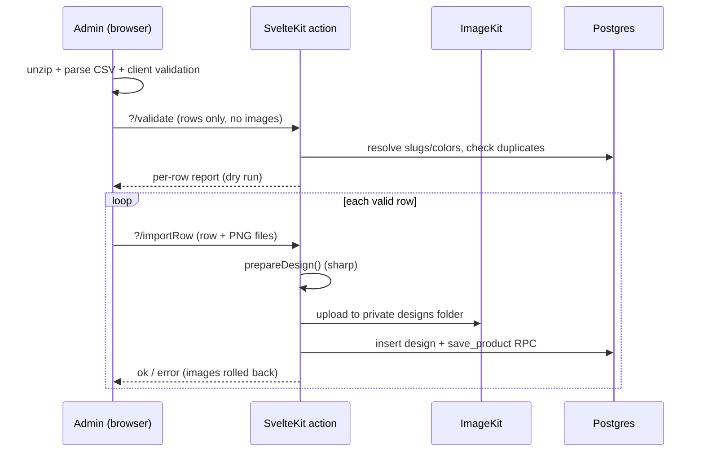

# Admin: bulk product import

Objective: new admin module `/admin/importar` to create products in bulk from a CSV, including every product field (some optional) and the design image. Data goes to Postgres (Supabase, through the existing `save_product` RPC); images go to ImageKit (private `designs` / `products` folders). Status: **plan, awaiting approval**. Delivery: `ask-on-risk`. Test runner: Vitest (`npm run test`), `npm run db:smoke`.

## Specs

- S1 — User: "Debe poderse cargar masivamente productos incluyendo todos los params (algunos opcionales) y la imagen del diseño, agregar pasos y plantilla del excel a usuario.".
- S2 — User: "hay que pensar en una solucion para poder cargarlas en algún tipo de csv con las imagenes".
- S3 — User: "los datos se guardan en la BD de postgres y las img en imagekit".

## Key decision: how images travel with the CSV

**Chosen: a ZIP package** = `productos.csv` + an `imagenes/` folder. The CSV references images by **file name** (`diseno_oscura = calavera-blanca.png`).

| Option                                     | Verdict  | Why                                                                                                           |
| ------------------------------------------ | -------- | ------------------------------------------------------------------------------------------------------------- |
| ZIP (CSV + images, referenced by filename) | chosen   | One file to upload, works offline, easy to prepare from Excel/Sheets + a folder, no external dependency.      |
| Image URLs in the CSV (server downloads)   | rejected | SSRF risk, depends on third-party hosting (Drive/Dropbox links are not direct), slow and flaky.               |
| Base64 inside the CSV                      | rejected | Files become huge (+33%), impossible to edit in a spreadsheet.                                                |
| CSV + multi-select of loose image files    | fallback | Same matching by filename; can be offered in the same UI for free since the browser parses both the same way. |

**Processing happens in the browser, one row per request.** The app is deployed on Vercel (`@sveltejs/adapter-vercel`), whose functions reject request bodies over 4.5 MB, so a whole ZIP can never be posted to the server. The browser unzips (`fflate`), parses the CSV (`papaparse`), validates, and then sends **one row + its images** per request to a form action. Benefits: no body/timeout limits, a live progress bar, per-row results, and a failed row does not abort the rest.

## CSV format (`productos.csv`, UTF-8, comma-separated)

References use human keys (slugs and names), never UUIDs.

| Column                 | Req.           | Maps to                         | Notes                                                                         |
| ---------------------- | -------------- | ------------------------------- | ----------------------------------------------------------------------------- |
| `nombre`               | yes            | `products.nombre`               |                                                                               |
| `slug`                 | no             | `products.slug`                 | Generated from `nombre` when empty; it is the idempotency key.                |
| `categoria`            | yes            | `products.category_id`          | Category slug.                                                                |
| `tipo_imagen`          | yes            | `products.tipo_imagen`          | `mockup` or `foto`.                                                           |
| `tipo_prenda`          | mockup: yes    | `products.garment_type_id`      | Garment type name (`Playera`, `Sudadera`).                                    |
| `diseno_nombre`        | no             | `designs.nombre`                | Defaults to `nombre`.                                                         |
| `diseno_oscura`        | mockup: 1 of 2 | `designs.path_prenda_oscura`    | PNG filename inside `imagenes/`.                                              |
| `diseno_clara`         | mockup: 1 of 2 | `designs.path_prenda_clara`     | PNG filename inside `imagenes/`.                                              |
| `diseno_existente`     | no             | `products.design_id`            | Reuse an existing design by name instead of uploading.                        |
| `colores`              | mockup: yes    | `product_colors`                | `negro\|blanco\|rojo` (garment base color names).                             |
| `fotos`                | foto: yes      | `product_images`                | `a.jpg\|b.jpg`, order = display order.                                        |
| `descripcion`          | no             | `products.descripcion`          | Default `''`.                                                                 |
| `precio`               | no\*           | `products.precio_base`          | In pesos (`170` or `170.50`), stored in cents. \*Required if no garment type. |
| `precio_oferta`        | no             | `products.precio_oferta`        | Pesos.                                                                        |
| `oferta_hasta`         | no             | `products.oferta_hasta`         | `YYYY-MM-DD`; requires `precio_oferta`.                                       |
| `modo_stock`           | no             | `products.modo_stock`           | `stock` or `bajo_pedido` (default).                                           |
| `stock`                | if `stock`     | `product_stock`                 | `negro:M=5;negro:G=3`.                                                        |
| `colecciones`          | no             | `product_collections`           | `halloween\|anime` (collection slugs).                                        |
| `permite_personalizar` | no             | `products.permite_personalizar` | `si/no`, default `no`.                                                        |
| `destacado`            | no             | `products.destacado`            | Default `no`.                                                                 |
| `activo`               | no             | `products.activo`               | Default `no` (imported as draft so the admin reviews first).                  |

Deliverable: a downloadable **template ZIP** (CSV with headers + 2 example rows + sample PNG) from the module page, so the format is self-documenting.

## Rules

- **Dry run first**: nothing is written until the full report shows; the admin confirms "Importar N filas válidas".
- **Duplicates**: an existing `slug` is reported as an error by default (option `actualizar existentes` is out of scope for v1 — see open questions).
- **Per-row atomicity**: images upload first; if `save_product` fails, the uploaded ImageKit files are deleted (`deleteImageByPath`). The existing orphan sweep (`src/lib/server/orphans.ts`) is the safety net.
- **Same validation as the manual form**: reuse `prepareDesign()` (PNG with transparency, 400 px min, 15 MB / 40 MP max) and the same product domain validation used by `ProductForm`, so both paths can never diverge.
- **Security**: actions behind the existing admin guard (`locals.getAdmin()`), ZIP limits in the browser (max files, max uncompressed size), filenames matched only against ZIP entries (no paths), CSV formula-injection irrelevant because we never export it back.
- **Limits**: max 500 rows per import; each request carries one row (images ≤ 4.5 MB per request on Vercel — see open questions).

## Tasks

| ID  | Specs  | Route  | Status | Description                                                                                                                                                                             |
| --- | ------ | ------ | ------ | --------------------------------------------------------------------------------------------------------------------------------------------------------------------------------------- |
| T1  | S1     | inline | done   | Pure domain modules `src/lib/domain/csv.ts`, `src/lib/domain/product-import.ts`, `src/lib/domain/import-template.ts`. Unit tests 26/26 green.                                           |
| T2  | S1, S3 | inline | done   | Server `src/lib/server/product-import.ts`: resolve slugs/names to ids in one batch query, duplicate check, `importPlannedRow()` with rollback on failure. Unit tests 7/7 green.         |
| T3  | S2     | inline | done   | Client `src/lib/client/import-package.ts`: `fflate` ZIP reader, CSV UTF-8/Windows-1252 decoder, filename matching, 4 MB budget downscaling. Unit tests 5/5 green.                       |
| T4  | S1, S2 | inline | done   | Route `src/routes/admin/(panel)/importar/` (`+page.svelte`, `+page.server.ts` with `validar` and `importar_fila` actions), nav entry in `nav.ts`, report table, progress, template ZIP. |
| T5  | S1–S3  | inline | done   | Typecheck (`svelte-check` 0 errors, 0 warnings), ESLint + Prettier clean, full test suite 40 files / 208 tests passing.                                                                 |

Route evidence: sequential units sharing the domain contract; no Writer trigger reason. Risk: T2 is **high** (writes persisted data + external storage, rollback logic).

## Decisions (resolved)

1. Existing `slug` is reported as a duplicate error in v1 (never overwrites).
2. Design/photo files exceeding the 4 MB per-row budget are downscaled in the browser via `OffscreenCanvas` before sending.
3. Both `mockup` and `foto` product types are supported.

## Log

- L1 (2026-11-03, user): "Crea un plan para agregar un nuevo modulo al panel administrativo: Debe poderse cargar masivamente productos incluyendo todo los params (algunos opcionales) y la imagen del diseño (hay que pensar en una solucion para poder cargarlas en algún tipo de csv con la imagenes) los datos se guardan en la BD de postgres y las img en imagekit".
- L2 (2026-11-03, user): "El plan me parece bien aplicalo" / "continua donde lo dejaron" — T1–T5 implemented and verified (`svelte-check` 0 errors, 208/208 tests green).
- L3 (2026-11-03, user): "implementa el 1, 3, 4 y 5" — Added design deduplication across rows in the same batch (`designKey` + `reused_design_id`), case/NFC/folder-prefix filename normalization (`normalizeFileName`), "Reintentar fallidos" action in the UI, and double-submit guard.
- L4 (2026-11-03, user): "agrega un pequeño modal de tutorial y boton para descargar la plantilla del csv + una explicacion de cada campo, debe ser visualmente facil de leer y simple" — Added 4-step tutorial modal (`bits-ui` Dialog), direct CSV template download (`downloadCsvTemplate`) alongside the example ZIP, catalog reference cards, and a clean field-by-field table (`IMPORT_FIELD_DOCS`, tested against `IMPORT_COLUMNS`).
