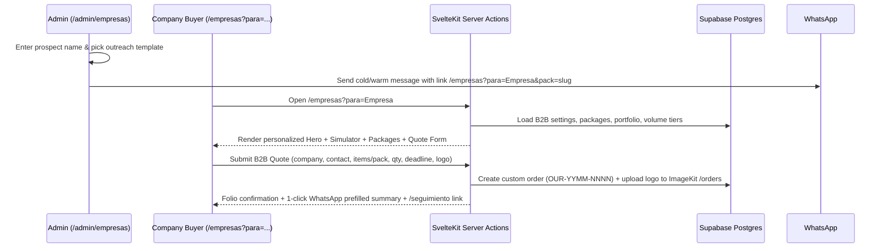

# Storefront & Admin: B2B Corporate Channel (`/empresas` & `/admin/empresas`)

Objective: build a high-conversion B2B landing page (`/empresas`), accessible from the main navbar and footer, paired with a configurable admin module (`/admin/empresas`) and an Outbound Prospecting Link & Message Generator so the business can send personalized links to companies and close wholesale/corporate deals. Status: **done**. Delivery: `ask-on-risk`. Test runner: Vitest (`npm run test`), `npm run check`, `npm run lint`.

## Specs

- S1 — User: "busca la vista o endpoint de empresas y quiero que sea accesible desde el navbar principal y el footer".
- S2 — User: "vamos a definirlo formalmente, como debe estar conformada la vista, que es lo que tiene que tener para ser altamente confiable y que sirva para cerrar tratos con empresas".
- S3 — User: "debe tener cosas de calidad de vida tanto para las empresas como para el administrador (paneles configurables, imagenes, etc) analiza profundamente y utiliza recursos de psicologia de ventas (dime cuales usas) queremos usar esta vista como un recursos para enviar junto a un mensaje para preguntar si las empresas necesitas de nuestros servicios."

## Sales Psychology Framework Applied

| Principle                                                 | Psychological Mechanism                                                                                        | Implementation in `/empresas`                                                                                                                                                                                              |
| --------------------------------------------------------- | -------------------------------------------------------------------------------------------------------------- | -------------------------------------------------------------------------------------------------------------------------------------------------------------------------------------------------------------------------- |
| **1. Cocktail Party Effect (Contextual Personalization)** | Decision-makers ignore generic brochures but pay immediate attention when they see their own company name.     | URL query support (`/empresas?para=Cafeteria+Central&pack=uniformes`) dynamically personalizes the hero badge and pre-selects the relevant corporate solution & form fields.                                               |
| **2. Price Anchoring & Transparent Volume Tiers**         | B2B buyers distrust opaque pricing ("they will overcharge me") yet need volume justification for their budget. | Interactive **Volume Savings Simulator**: shows unit retail price crossed out (anchor), unit wholesale tier price (12+, 25+, 50+, 100+ pcs), and total savings in MXN.                                                     |
| **3. Risk Reversal (Loss Aversion Mitigation)**           | Corporate buyers fear missed event deadlines and poor logo reproduction more than price.                       | Explicit **3-Pillar B2B Guarantee Block**: (1) Free digital mockup before production, (2) Written delivery date commitment with live tracking folio (`/seguimiento`), (3) 50% deposit & balance upon finished photo proof. |
| **4. Domain-Specific Social Proof**                       | Pop-culture catalog items do not convince HR or purchasing managers; they need to see corporate deliverables.  | Curated **B2B Portfolio & Case Studies** grid showing real delivered batches (e.g., laser-engraved tumblers, staff uniforms, 3D trophies/keychains) with piece counts and industry tags.                                   |
| **5. Choice Architecture (Bundling vs. Choice Overload)** | Buyers often know the occasion (onboarding, anniversary, expo) but get paralyzed choosing individual items.    | Configurable **Ready-to-Quote Corporate Packages** (e.g., _Kit Onboarding_, _Pack Uniforme + Termo_, _Kit Evento/Expo_). Clicking one pre-fills the quote builder.                                                         |
| **6. Endowment Effect (Visual Ownership)**                | Seeing one's own brand on a physical product triggers psychological ownership before purchase.                 | **Instant Client-Side Logo Previewer**: the buyer drops their logo (PNG/JPG/WebP) to preview it on a sample garment/tumbler stage and attach it directly to the quote request.                                             |
| **7. Foot-in-the-Door (Frictionless Dual CTA)**           | Long fiscal forms kill cold-outreach conversion.                                                               | Dual conversion path: 1-click direct WhatsApp chat (with personalized context) OR 3-step structured quote builder that generates an official `OUR-YYMM-NNNN` folio.                                                        |

## Architecture & Data Model

### Database Schema (`supabase/migrations/<ts>_empresas_b2b.sql`)

1. **`b2b_settings` (singleton table, `id = 1`)**:
   - `hero_titulo`, `hero_subtitulo`, `badge_texto`
   - `stat_piezas_entregadas` (e.g. `"+1,500 piezas entregadas"`), `stat_tiempo_respuesta` (e.g. `"Cotización en < 2 horas"`), `stat_minimo_piezas` (e.g. `"Desde 10 piezas"`)
   - `garantias` (JSONB array of `{ titulo, descripcion }`)
   - `faqs` (JSONB array of `{ pregunta, respuesta }` — billing/invoices, lead times, file formats, shipping)
   - `escalas_simulador` (JSONB array of configurable product lines & volume brackets `[10, 25, 50, 100]` with unit prices in cents)
2. **`b2b_packages` (configurable corporate bundles & service lines)**:
   - `id`, `slug`, `nombre`, `subtitulo`, `descripcion`, `incluye` (text[]), `precio_desde` (cents), `cantidad_minima` (int), `imagekit_path` (nullable), `destacado` (boolean), `activo` (boolean), `orden` (int)
3. **`b2b_portfolio` (corporate work showcase)**:
   - `id`, `titulo`, `giro_empresa` (e.g. `"Cafetería · 40 piezas"`), `imagekit_path`, `activo` (boolean), `orden` (int)
4. **`wa_templates` seeds for Outbound Prospecting**:
   - `b2b_prospeccion_frio` (Cold outreach message with `{{empresa}}`, `{{contacto}}`, `{{link_empresas}}`)
   - `b2b_prospeccion_seguimiento` (Follow-up message)
   - `b2b_cotizacion_nueva` (Client-to-business WhatsApp summary when submitting a B2B quote)

## Scope Breakdown

### 1. Navigation Access (`StoreHeader.svelte`, `StoreFooter.svelte`, `sitemap.xml`)

- **Main Navbar (`StoreHeader.svelte`)**:
  - Desktop center nav (`lg:flex`): add `Empresas` link with active state indicator.
  - Mobile drawer (`Panel`): add `Empresas` link in main list and secondary CTA button next to `Encargos especiales`.
- **Footer (`StoreFooter.svelte`)**:
  - Add `Empresas y mayoreo` under the "Tienda" or "Contacto" column.
- **Sitemap (`src/routes/sitemap.xml/+server.ts`)**:
  - Include `/empresas` for organic B2B search indexing.

### 2. Public B2B Landing View (`src/routes/(store)/empresas/`)

- **Personalized Editorial Hero**:
  - Reads `?para=` and `?pack=` query parameters safely (sanitized text, max 60 chars) to display a tailored greeting badge (`Propuesta corporativa para {Empresa}`) without exposing or storing anything until submitted.
  - Trust bar with key operational metrics (`stat_piezas_entregadas`, `stat_tiempo_respuesta`, `stat_minimo_piezas`).
- **Solutions & Corporate Packages Grid**:
  - Cards for each active `b2b_package` (Uniformes y Textil, Termos y Grabado Láser, Kits de Onboarding, Eventos y Promocionales 3D/Cricut) with "Desde $X / pza", minimum quantity badge, included items list, and a `"Cotizar este paquete"` button that scrolls to and pre-populates the quote form.
- **Interactive Volume Savings Simulator & Logo Previewer**:
  - Pick product category + slide quantity (10 to 200+ units) → live calculation of unit price, normal price crossed out, and total savings in MXN.
  - Optional **"Previsualiza tu logo"**: client selects their logo image locally to see how it contrasts on a dark/light surface and automatically attaches it to the quote form below.
- **B2B Social Proof & Risk-Reversal Guarantees**:
  - Portfolio grid of real corporate projects served with watermark via `/img/b2b/[id]`.
  - 3-step visual timeline (_1. Envías tu idea o logo → 2. Recibes mockup digital y cotización formal → 3. Producción con anticipo del 50% y seguimiento en línea_).
  - B2B FAQ accordion (tiempos de producción, formatos de logo, envíos a todo México, pagos y comprobantes).
- **Structured B2B Quote Form (`POST ?/cotizar`)**:
  - Captures: `empresa_nombre`, `cliente_nombre`, `cliente_whatsapp`, `correo_opcional`, `paquete_o_servicio`, `cantidad_estimada`, `fecha_evento`, `metodo_entrega`, `notas_proyecto`, and up to 5 reference/logo files (downscaled client-side, stored privately in `/ouroboros/orders/<folio>/`).
  - Creates a tracked order in Postgres (`OUR-YYMM-NNNN`) so the admin manages it in `/admin/pedidos/[id]` with full quote, payment, and status history.

### 3. Admin B2B Control Center (`src/routes/admin/(panel)/empresas/`)

- **Tab 1 — Outbound Prospecting Generator (QoL for closing deals)**:
  - Inputs: _Nombre de la empresa_, _Nombre del contacto (opcional)_, _Paquete recomendado_, _Nota personalizada_.
  - Outputs:
    - 1-click **Copy Personalized Link** (`https://.../empresas?para=...&pack=...`).
    - Live preview of the outreach message (using editable templates) with **1-click Copy Text** and **Open in WhatsApp** buttons.
- **Tab 2 — Corporate Packages CRUD**:
  - Create, edit, reorder, toggle active/featured, and upload cover photo for `b2b_packages`.
- **Tab 3 — B2B Portfolio & Case Studies**:
  - Upload photos of finished corporate orders with title and industry/quantity tag (`giro_empresa`).
- **Tab 4 — Simulator Tiers, Guarantees & FAQs**:
  - Configure volume simulator brackets, hero copy, trust metrics, guarantees, and B2B FAQs without touching code.

## Tasks

| ID  | Specs  | Route  | Status | Description                                                                                                                                                                                                                       |
| --- | ------ | ------ | ------ | --------------------------------------------------------------------------------------------------------------------------------------------------------------------------------------------------------------------------------- |
| T1  | S1–S3  | inline | done   | Migration `supabase/migrations/20261104000000_empresas_b2b.sql`: tables `b2b_settings`, `b2b_packages`, `b2b_portfolio`, RLS policies, initial realistic seeds, and B2B WhatsApp templates. Update `src/lib/types/database.ts`.   |
| T2  | S2, S3 | inline | done   | Pure domain `src/lib/domain/b2b.ts` (+ 13 unit tests in `b2b.spec.ts`): volume simulator calculation, personalized URL builder/sanitizer, B2B quote validation, and outbound message formatting.                                  |
| T3  | S2, S3 | inline | done   | Image endpoint `src/routes/img/b2b/[id]/+server.ts` + server helpers `src/lib/server/b2b.ts` for loading B2B config, uploading portfolio/package images to ImageKit, and registering B2B quote orders.                            |
| T4  | S1–S3  | inline | done   | Public view `src/routes/(store)/empresas/` (`+page.server.ts`, `+page.svelte`) + links in `StoreHeader.svelte`, `StoreFooter.svelte`, and `sitemap.xml/+server.ts`.                                                               |
| T5  | S3     | inline | done   | Admin module `src/routes/admin/(panel)/empresas/` (`+page.server.ts`, `+page.svelte`) + entry in `src/routes/admin/(panel)/nav.ts`: Outbound Prospecting Generator, Packages CRUD, Portfolio manager, and Simulator/FAQ settings. |
| T6  | S1–S3  | inline | done   | Verification: `npm run check` (0 errors, 0 warnings), `eslint` (0 errors), `vitest` (13/13 passed).                                                                                                                               |

Route evidence: cohesive vertical feature sharing `b2b.ts` domain and database schema; no Writer delegation trigger. Risk: **medium** (additive tables and routes; reuses existing order creation & ImageKit pipelines).

## Log

- L1 (2026-11-04, user): "busca la vista o endpoint de empresas y quiero que sea accesible desde el navbar principal y el footer".
- L2 (2026-11-04, user): "vamos a definirlo formalmente, como debe estar conformada la vista, que es lo que tiene que tener para ser altamente confiable y que sirva para cerrar tratos con empresas, debe tener cosas de calidad de vida tanto para las empresas como para el administrador (paneles configurables, imagenes, etc) analiza profundamente y utiliza recursos de psicologia de ventas (dime cuales usas) queremos usar esta vista como un recursos para enviar junto a un mensaje para preguntar si las empresas necesitas de nuestros servicios."
