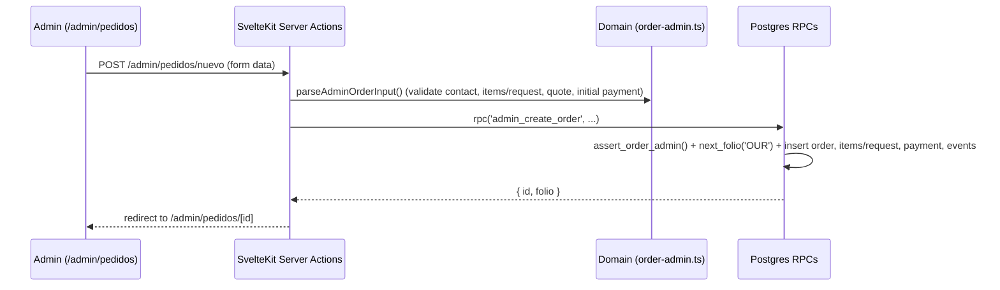

# Admin: manual orders, full order editing & QoL improvements

Objective: extend `/admin/pedidos` and `/admin/pedidos/[id]` so the admin can create orders manually (`catalogo` or `encargo`), edit or add order parameters after creation (customer/delivery info, line items, custom request details, discounts, and mis-entered payments/notes), revert/reopen order status with an audit note, and work faster with quality-of-life (QoL) tools. Status: **done**. Delivery: `ask-on-risk`. Test runner: Vitest (`npm run test`), `npm run check`, `npm run lint`.

## Specs

- S1 — User: "en el modulo de pedidos admin/pedidos quiero que podamos hacer pedidos manualmente".
- S2 — User: "modificar o agregar parametros del pedido".
- S3 — User: "agrega opciones de calidad de vida y preguntame si necesito o quiero opciones adicionales y cuales son".
- S4 — User: "agregaremos la D" (allow reopening/rolling back order status with mandatory audit note in `order_events`).

## Architecture & Key Decisions

1. **Dedicated admin RPCs (`SECURITY INVOKER` + `assert_order_admin()`)**:
   - Storefront `create_order` and `create_custom_order` enforce public rate limits (5 pending/hour per WhatsApp) and always start in `pendiente` with unquoted shipping.
   - New admin RPC `admin_create_order` skips storefront spam limits, generates the atomic `OUR-YYMM-NNNN` folio via `next_folio`, supports both `'catalogo'` and `'encargo'`, allows optional immediate quote fields (`envio`, `personalizacion`, `anticipo_requerido`, `desc_mayoreo`, `desc_cupon`) and an optional initial payment (`anticipo` or `liquidacion`), recording the corresponding `order_events` in a single transaction.
2. **Safe mutation of existing orders while preserving financial invariants**:
   - Postgres constraint on `orders` requires: `total = subtotal - desc_mayoreo - desc_cupon + coalesce(personalizacion, 0) + coalesce(envio, 0)` and `total >= 0`.
   - Furthermore, any edit that recalculates `total` must verify `new_total >= pagado` (sum of `payments.monto`) and `estado not in ('entregado', 'cancelado')`.
   - New admin RPCs (`admin_update_order_details`, `admin_save_order_items`, `admin_update_custom_request`, `admin_delete_payment`) enforce these invariants transactionally with `SELECT ... FOR UPDATE`.
3. **Hybrid line items (Catalog + Free-form snapshot)**:
   - `order_items.product_id` is already nullable (`ON DELETE SET NULL`). Admin order creation and item editing can either pick an active/inactive catalog product (auto-filling `nombre_snapshot`, `color`, `talla`, `precio_unitario`, `recargo_talla`) or enter a custom line item (`product_id = null`).

## Scope Breakdown

### 1. Manual Order Creation (`/admin/pedidos/nuevo`)

- **Customer & Delivery**: `cliente_nombre`, `cliente_whatsapp` (10 digits normalized to `52XXXXXXXXXX`), `metodo_entrega` (`recoger` | `domicilio` | `paqueteria`), conditional `direccion` (`calle`, `colonia`, `cp`, `ciudad`, `estado`, `referencias`), `notas_cliente`.
- **Order Type (`tipo`)**:
  - `catalogo`: dynamic list of line items — search/pick from catalog (auto-fills base price, size surcharge, available colors/sizes) or add a manual line (`nombre_snapshot`, `color`, `talla`, `cantidad`, `precio_unitario`, `recargo_talla`, `personalizacion_texto`).
  - `encargo`: `custom_request_type_id`, `descripcion`, `cantidad`, `fecha_deseada`, `precio_final`.
- **Initial Quote & Payment (in one step)**:
  - Capture `personalizacion`, `envio` (auto `0` when `recoger`), `desc_mayoreo` (auto-suggested from wholesale tiers or manual override), manual discount (`desc_cupon`), and `anticipo_requerido` (with 50% quick button).
  - Optional initial payment (`ninguno` | `anticipo` | `liquidacion` + `monto` + `metodo`), allowing the order to be created directly in `pendiente`, `esperando_anticipo`, or `confirmado`.

### 2. Modifying & Adding Order Parameters (`/admin/pedidos/[id]`)

- **Customer, Delivery & Notes (`?/datos`)**:
  - Edit `cliente_nombre`, `cliente_whatsapp`, `metodo_entrega`, `direccion`, `notas_cliente`, and `guia`.
  - Switching `metodo_entrega` to `recoger` automatically sets `envio = 0` and recalculates `total`.
- **Line Items (`?/partidas` for `catalogo`) & Custom Request (`?/encargo` for `encargo`)**:
  - Add new catalog or manual line items, edit `cantidad`, `talla`, `color`, `precio_unitario`, `recargo_talla`, `personalizacion_texto`, or remove a line item (minimum 1 item required).
  - Edit `custom_request_type_id`, `descripcion`, `cantidad`, and `fecha_deseada` on custom orders.
  - Automatically recomputes `subtotal` and `total`, rejecting if `new_total < pagado`.
- **Extended Quote & Discounts (`?/cotizar`)**:
  - Extend existing quote form to also allow editing `desc_mayoreo` and `desc_cupon` (manual discount in cents) alongside `envio`, `personalizacion`, `precio_final`, and `anticipo_requerido`.
- **Payment & Note Corrections (`?/eliminarPago`, `?/eliminarNota`)**:
  - Delete a mis-entered payment (blocked if deleting the only `anticipo` on an order already in `confirmado` or later, unless another `anticipo` exists) or delete an internal note.
- **Status Rollback / Reopen (`?/revertirEstado` — S4)**:
  - Allow the admin to move an order back to a previous state or reopen a `cancelado` / `entregado` order when triggered by mistake.
  - Requires a non-empty reason (`nota`), validates invariants for the target state (e.g., moving to `confirmado`/`en_produccion`/`listo` still requires at least one `anticipo` payment), and records an explicit `[Corrección de estado] ...` event in `order_events`.

### 3. Built-in Quality of Life (QoL) Improvements

- **Recurring Customer Autocomplete**: lookup by WhatsApp digits or name in `/admin/pedidos/nuevo` from past `orders` to prefill customer name, phone, delivery method, and address in one click.
- **One-Click Payment Chips**: in `/admin/pedidos/[id]`, buttons on the payment form to prefill "Anticipo requerido", "50% del total", or "Liquidar saldo ($...)".
- **Quick Copy Bar**: 1-click buttons in order detail to copy Folio, copy public Tracking URL (`/seguimiento?folio=...`), or copy a formatted WhatsApp order summary.
- **Richer List Filters in `/admin/pedidos`**: filter by `metodo_entrega` (`recoger` | `domicilio` | `paqueteria`) and payment status (`con_saldo` | `liquidado` | `sin_cotizar`) in addition to `estado`, `tipo`, and search `q`.

## Tasks

| ID  | Specs          | Route  | Status | Description                                                                                                                                                                                                                                                                                                                                                                              |
| --- | -------------- | ------ | ------ | ---------------------------------------------------------------------------------------------------------------------------------------------------------------------------------------------------------------------------------------------------------------------------------------------------------------------------------------------------------------------------------------- |
| T1  | S1, S2, S4     | inline | done   | Migration `supabase/migrations/20261104020000_admin_pedidos_manuales.sql`: RPCs `admin_create_order`, `admin_update_order_details`, `admin_save_order_items`, `admin_update_custom_request`, `admin_delete_payment`, `admin_override_order_status`, and extended `quote_order` with `assert_order_admin()` and financial invariant checks. Updated `database.ts`.                        |
| T2  | S1, S2, S3, S4 | inline | done   | Pure domain `src/lib/domain/order-admin.ts` (+ 16 unit tests in `src/lib/domain/order-admin.spec.ts`): schemas and parsers for manual order creation, hybrid line items, customer/delivery updates, extended quote/discounts, status override validation, and recurring customer deduplication.                                                                                          |
| T3  | S1, S3         | inline | done   | New route `src/routes/admin/(panel)/pedidos/nuevo/` (`+page.server.ts`, `+page.svelte`): manual order builder (`catalogo` + `encargo`), recurring customer autocomplete, catalog/free-line picker, live totals preview, and optional initial payment/status.                                                                                                                             |
| T4  | S2, S3, S4     | inline | done   | Extended `src/routes/admin/(panel)/pedidos/[id]/` (`+page.server.ts`, `+page.svelte`): editable customer/delivery section (`?/datos`), line item editor (`?/partidas`), custom request editor (`?/encargo`), discount fields in `?/cotizar`, payment/note deletion (`?/eliminarPago`, `?/eliminarNota`), status rollback/reopen (`?/revertirEstado`), payment chips, and quick copy bar. |
| T5  | S3             | inline | done   | Extended `src/routes/admin/(panel)/pedidos/` (`+page.server.ts`, `+page.svelte`): "Nuevo pedido manual" CTA button, delivery method filter (`entrega`), and balance/quote status filter (`pago`).                                                                                                                                                                                        |
| T6  | S1–S4          | inline | done   | Verification: `svelte-check` 0 errors / 0 warnings, ESLint + Prettier clean, Vitest server suite 41 files / 239 tests green.                                                                                                                                                                                                                                                             |

Route evidence: sequential units sharing the same Postgres RPC and `order-admin.ts` domain contracts; no Writer trigger reason. Risk: T1 is **high** (transactional order/payment mutations and financial invariants in Postgres).

## Log

- L1 (2026-11-04, user): "arma el plan: en el modulo de pedidos admin/pedidos quiero que podamos hacer pedidos manualmente y modificar o agregar parametros del pedido, agrega opciones de calidad de vida y preguntame si necesito o quiero opciones adicionales y cuales son".
- L2 (2026-11-04, user): "agregaremos la D y dame mas opciones" — Added S4 (`admin_override_order_status` + `?/revertirEstado` with mandatory audit note in `order_events`).
- L3 (2026-11-04, user): "ninguno de los nuevos, comienza como esta" — Implemented T1–T6 and verified (`svelte-check` 0 errors, ESLint/Prettier clean, 41/41 test files passing).
